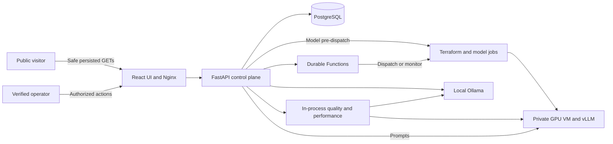

# LLM Serving Demo

An Azure-backed LLM serving lab: provision a GPU environment, deploy vLLM, exercise
prompts, and retain comparable quality/performance reports. A local Ollama adapter
supports development without Azure. The control plane is FastAPI/PostgreSQL with a
React/Vite UI, Durable Functions and Container Apps Jobs.

**Try the [public demo](https://servinglab.liberatetheinnerchild.net).**
Every screen has a read-only view of sanitized persisted data. Sign-in is required
for provisioning, deployment, prompts, runs, configuration saves, exports and
side-effecting previews. Anonymous access never invokes inference or Azure and
never exposes raw cases/prompts/outputs, credentials or private infrastructure.

**Status, 2026-11-07:** real deployed Qwen3-4B/vLLM acceptance has passed on the
existing Azure demo. Recent observations include golden **12/12** and a
50-request, concurrency-10 performance run with five verified warm-ups, zero
failures, **167.6 tokens/sec** and **369.6 ms p95 TTFT**. These are dated small-run
observations, not an SLA, benchmark calibration or reproducible-release promise.
Spot compute remains interruptible; Regular allocation was denied by subscription
policy. See [evidence and limitations](docs/RELEASE_VALIDATION.md).

## Start here

| Goal | Guide |
| --- | --- |
| Browse or present the application | [Demo walkthrough](docs/DEMO.md) |
| Find documentation by task | [Documentation index](docs/README.md) |
| Understand the system at increasing depth | [Architecture map](docs/ARCHITECTURE.md) |
| Develop locally | [Backend](backend/README.md), [frontend](frontend/README.md), [testing](docs/TESTING.md) |
| Configure an authorized private operator | [Operator inputs](docs/OPERATOR_CONFIGURATION.md), [authentication](docs/AUTHENTICATION.md) |
| Bring up a new Azure target safely | [Infrastructure](infra/README.md), [release gates](docs/AZURE.md), [app bootstrap](docs/APP_BOOTSTRAP.md) |
| Preserve configurations/reports and recover | [Data and backup](docs/DATA_AND_RECOVERY.md), [state leases](docs/TERRAFORM_STATE.md), [operations](docs/OPERATIONS.md) |

## Local development

Use Python 3.11+, Node 20 (CI's version), npm and a **disposable** reachable
PostgreSQL database. Ollama is optional for real local inference. Azure login
and Terraform are not required for local development.

From the repository root, in PowerShell:

```powershell
cd backend
python -m venv .venv
.\.venv\Scripts\Activate.ps1
python -m pip install -e '.[dev]'
Copy-Item .env.example .env
```

Edit the untracked `backend/.env` to set your disposable `DATABASE_URL`.
Keep `AUTH_MODE=local-demo`, `APP_ENV=development`, and
`AUTH_ALLOWED_EMAIL_DOMAINS=example.com` **only on a loopback development backend**.
Set `CORS_ALLOWED_ORIGINS=http://localhost:5173` for Vite; use its actual browser
origin if the port changes. Do not use wildcard CORS or local-demo on a cloud host.
The safe cloud default is signed `entra-jwt` authentication.

Continue in that backend shell:

```powershell
python -m alembic upgrade head
python -m src.persistence.seed_catalog
python -m src.evaluation.seed_benchmarks
python -m src.evaluation.seed_golden_datasets
python -m src.performance.seed_workloads
uvicorn src.api.app:app --reload --host 127.0.0.1 --port 18000
```

In a second shell from the repository root:

```powershell
cd frontend
npm ci
$env:VITE_API_BASE_URL = 'http://127.0.0.1:18000'
$env:VITE_DEMO_USER = 'presenter@example.com'
npm run dev -- --host localhost
```

Open the URL printed by Vite. For real inference, start your own local Ollama
runtime, run `ollama pull qwen2.5:0.5b-instruct`, then choose **Local (Ollama)** in
Provision. Follow [the walkthrough](docs/DEMO.md#local-operator-walkthrough) through
Deploy, Exercise, Quality and Performance. Local golden/prompt/native performance
flows do not require Azure. Benchmarks need the backend's `evaluation` extra;
genuine vLLM LLMPerf additionally needs the separately pinned toolkit packaged in
the backend image, not the unrelated PyPI `llmperf` package.

`GET /healthz` is API liveness; `GET /readyz` is bounded database readiness,
not GPU/model warmth. See [backend setup](backend/README.md) for full configuration
and [testing](docs/TESTING.md) for exact coverage and commands.

## Architecture at a glance



Shared networking/registry/vault/monitoring and the control plane outlive demo GPU
environments. `infra/demo` supports both managed disposable groups and explicitly
approved retained groups with fresh data-only group state. Teardown must preserve
retained groups, shared/control resources and other environments.

Provision/teardown/model deployment use durable job monitoring. **Quality and
performance still run in the backend process**, with reports/snapshots persisted
in PostgreSQL. Evaluation/performance/export worker definitions exist, but are not
the API run path and do not certify process-restart recovery. AWS/GCP are design
directions, not working adapters. [Layered diagrams](docs/ARCHITECTURE.md) distinguish
these implemented paths from optional infrastructure and pending gates.

## Deployment and safety

PR/push CI checks code, database contracts, containers and credential-free
Terraform plans; it never deploys to Azure. Cloud image updates require protected
manual-main dispatch, `ENABLE_AZURE_DEPLOYMENT=true` and the `azure-deployment`
environment. Separate operator workflows have their own disabled-by-default
configuration/approval gates. Importing this repository configures no identity,
connection, resource or cloud access.

New targets require reviewed ownership, private state/locking/backups, artifact
digests, actual SSO/token relay, exact GPU quota/policy, bounded costs and
independent cleanup. Existing-target success does not satisfy those gates for a
new tenant or subscription. Default Terraform image tags and local cross-module
state are not a clean production bootstrap. Never bypass policy or weaken auth.
See [private setup](docs/OPERATOR_CONFIGURATION.md) and [Azure gates](docs/AZURE.md).

The database is PostgreSQL Flexible Server, not an idle-auto-pausing serverless
database. Explicit stop/start and external subscription shutdown automation are
separate operational concerns; [the availability runbook](docs/DATA_AND_RECOVERY.md#database-availability)
explains what to inspect without inventing an `autoPauseDelay` setting.

## Extending to AWS or GCP

Neither cloud is implemented today. Start with one provider and retain the
existing API/report contracts: implement its lifecycle and honest quota/capacity
checks, approved identity/private networking/secrets, isolated Terraform state
and recovery, job orchestration/artifact publication, private vLLM deployment,
provider-aware UI/configuration and full contract/real-model acceptance.
Do not replace Azure or simply point its ARM/managed-identity workers at another
cloud. [The high-level roadmap and coding-agent starter prompt](docs/PROVIDER_EXTENSION.md)
identify current extension seams and platform-specific decisions without claiming
ready AWS/GCP capabilities.

## License and contributions

Application source is [MIT](LICENSE); retain
[third-party attribution](THIRD_PARTY_NOTICES.md). No model weights, private
deployment files or raw acceptance reports are included. Check each exact model
revision and dataset's license/gated terms independently; catalog labels are not
a license grant.

Follow [contribution and review gates](CONTRIBUTING.md) and
[private vulnerability reporting](SECURITY.md). Specifications under
[`specs/001-llm-serving-demo`](specs/001-llm-serving-demo) preserve design intent and
task history; current source and the architecture/evidence guides take precedence.
