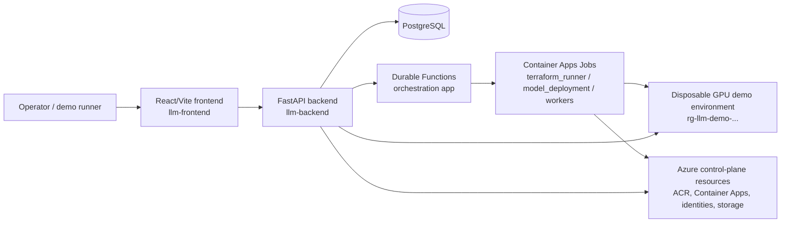

# Azure LLM Serving Demo

Azure LLM Serving Demo is a control-plane application for operators and demo runners who need to stand up Azure-hosted LLM inference environments quickly, deploy a model into them, exercise prompts, and capture quality/performance evidence without hand-building infrastructure for every demo.

The current repository contains:

- a FastAPI backend control plane
- a React/Vite operator UI
- Durable Functions + Container Apps Job orchestration for infrastructure/model deployment
- Terraform for the shared platform, persistent control plane, and disposable per-demo GPU environments

Several later-stage UI areas are still scaffolded rather than fully productized (`Compare`, `Retune`, `Teardown`, and `Experiment History` pages), but provisioning, deployment, prompt exercise, and run/report flows are all represented in code today.

## Repository guide

- [`backend/README.md`](backend/README.md) - backend-specific setup, local Ollama mode, and validation commands
- [`frontend/README.md`](frontend/README.md) - frontend setup, lint/unit-test commands, and Playwright smoke test
- [`infra/README.md`](infra/README.md) - Terraform module split, bring-up order, and control-plane vs. demo-environment isolation
- [`specs/001-llm-serving-demo/`](specs/001-llm-serving-demo/) - spec-kit artifacts (`spec.md`, `plan.md`, `research.md`, `tasks.md`) that describe the feature intent and planned architecture
- [`docs/ARCHITECTURE.md`](docs/ARCHITECTURE.md) - deeper architecture reference with multiple views and runtime diagrams
- [`docs/AZURE_CANARY.md`](docs/AZURE_CANARY.md) - protected OIDC and independent failure/cancellation cleanup gate; not application or billable-resource cleanup validation
- [`docs/TESTING.md`](docs/TESTING.md) - complete CI commands, real PostgreSQL coverage, and explicit mocked/full-stack evidence boundaries
- [`docs/PROVIDERS.md`](docs/PROVIDERS.md) - implemented Azure/local capabilities and explicit, non-blocking AWS/GCP limitations

## Prerequisites

### Tooling

| Requirement | Verified source |
|---|---|
| Azure CLI with access to the target subscription | Used throughout `.github/workflows/backend.yml`, `.github/workflows/frontend.yml`, and by the Terraform/job flow |
| Terraform `1.9.8` recommended (`>= 1.7.0` required by modules) | `.github/workflows/infra.yml`, `infra/*/providers.tf` |
| Python `3.11+` | `backend/pyproject.toml` |
| Node.js `20` recommended in CI (`18+` documented for local frontend work) | `.github/workflows/frontend.yml`, `frontend/README.md` |
| npm `9+` | `frontend/README.md` |
| Reachable PostgreSQL instance | `backend/README.md`, `backend/.env.example` |
| Docker (optional) if you want to build images locally; not required for normal local dev | The repo uses Dockerfiles plus `az acr build` in CI/CD |

### Azure access and permissions

You need an Azure subscription and enough RBAC to:

- apply `infra/shared` and `infra/control`
- create/update the control-plane resources in `rg-llm-control-{stage}`
- allow per-environment GPU resource creation for `infra/demo`

For GitHub Actions deployment, the checked-in workflows expect these repository secrets for OIDC-based Azure login:

- `AZURE_CLIENT_ID`
- `AZURE_TENANT_ID`
- `AZURE_SUBSCRIPTION_ID`

Pushes and pull requests never deploy. Deployment is disabled by default and requires
all of the following: repository variable `ENABLE_AZURE_DEPLOYMENT=true`, a manual
workflow dispatch on `main` with `deploy=true`, and a configured `azure-deployment`
GitHub environment. Restrict that environment to `main` and add required reviewers
before enabling deployment. Configure OIDC trust for that environment, not arbitrary
pull requests.

Set `AZURE_RESOURCE_GROUP`, `AZURE_ACR_NAME`, `AZURE_BACKEND_APP_NAME`, and
`AZURE_FRONTEND_APP_NAME` as environment variables in GitHub's environment settings
(configuration variables, not shell variables). No Azure identity or resources are
configured by importing this repository.

### Backend environment variables

Copy `backend/.env.example` to `backend/.env` and set values appropriate for your environment.

Most important settings:

- `DATABASE_URL`
- `AZURE_SUBSCRIPTION_ID`
- `AZURE_TENANT_ID`
- `AZURE_CLIENT_ID`
- `INTERNAL_API_AUDIENCE` (needed when Durable Functions / job callbacks authenticate to the backend)
- `HF_TOKEN_PASSTHROUGH_HEADER`
- `AUTH_ALLOWED_EMAIL_DOMAINS`
- `AUTH_BYPASS_PATHS`
- `DEFAULT_ALLOWED_SSH_SOURCE_CIDR`
- `DEFAULT_ALLOWED_API_SOURCE_CIDR`
- `VLLM_IMAGE`
- `LM_EVAL_PATH`
- `LLMPERF_PATH`

### Frontend environment variables

The frontend reads:

- `VITE_API_BASE_URL`
- `VITE_DEMO_USER`

Create an untracked `frontend/.env.local` with `VITE_API_BASE_URL=http://127.0.0.1:18000`
and, for local development only, `VITE_DEMO_USER=presenter@example.com`. The sample backend
allows `example.com`; set `AUTH_ALLOWED_EMAIL_DOMAINS` explicitly for your deployment.
Demo headers are not production authentication: use a trusted authenticating proxy
that strips caller-supplied identity headers before exposing the API.

## Getting started

Before provisioning Azure resources, sign in with the Azure CLI:

```powershell
az login
```

### 1) Backend

```powershell
cd backend
python -m venv .venv
.\.venv\Scripts\Activate.ps1
pip install -e .[dev]
Copy-Item .env.example .env
alembic upgrade head
python -m src.persistence.seed_catalog
python -m src.evaluation.seed_benchmarks
uvicorn src.api.app:app --reload --port 18000
```

Optional tooling for evaluation-focused backend work:

```powershell
pip install -e .[evaluation]
```

Useful backend endpoints while developing:

- `GET /healthz`
- `GET /docs`

### 2) Frontend

```powershell
cd frontend
npm install
npm run dev
```

The frontend expects the backend at `VITE_API_BASE_URL`; set it as described above.

### 3) Optional local-only demo mode

If you do not want to provision Azure GPU infrastructure during development, the backend includes a local Ollama path:

```powershell
ollama pull qwen2.5:0.5b-instruct
```

Then choose the `local-ollama` profile in the UI. See [`backend/README.md`](backend/README.md) for the full local flow.

## Infrastructure provisioning and deployment

The Terraform layout is intentionally split into three independent modules:

1. `infra/shared` - long-lived shared networking, ACR, Key Vault, and monitoring
2. `infra/control` - long-lived control plane (backend/frontend Container Apps, Functions app, jobs, PostgreSQL, storage, identities)
3. `infra/demo` - disposable per-environment GPU VM resources

Bring-up order follows [`infra/README.md`](infra/README.md):

```powershell
cd infra\shared
terraform init
terraform apply -var "subscription_id=<your-subscription-guid>"

cd ..\control
terraform init
terraform apply -var "subscription_id=<your-subscription-guid>"
```

Notes:

- `stage` defaults to `dev`
- `infra/shared` defaults to `polandcentral`
- `infra/demo` is **not** intended to be applied by hand for each environment; it is executed asynchronously by the `terraform_runner` Container Apps Job
- `infra/control` can validate before images exist, but the apps/jobs will not run successfully until real images are available in ACR

## CI/CD as checked into this repo

### Backend (`.github/workflows/backend.yml`)

On PRs and relevant pushes:

- installs the backend with dev extras
- runs `ruff check src tests`
- runs `black --check src tests`
- runs `pytest -q`

Only on an explicitly enabled manual deployment dispatch from `main`:

- logs into Azure with `azure/login@v2` (OIDC)
- builds and pushes `llmserving-backend:${github.sha}` with `az acr build`
- points Container App `llm-backend` at that immutable SHA tag
- polls `https://<fqdn>/healthz`

### Frontend (`.github/workflows/frontend.yml`)

On PRs and relevant pushes:

- runs `npm ci`
- runs `npm run lint`
- runs `npm run build`
- runs `npm test`

Only on an explicitly enabled manual deployment dispatch from `main`:

- logs into Azure with OIDC
- resolves the live backend Container App FQDN
- builds and pushes `llmserving-frontend:${github.sha}` with `az acr build`
- passes `VITE_API_BASE_URL=https://<backend-fqdn>` as a build arg
- points Container App `llm-frontend` at that immutable SHA tag
- polls the frontend root URL

### Terraform validation (`.github/workflows/infra.yml`)

This workflow does **static validation only**:

- `terraform fmt -check -recursive`
- `terraform init -backend=false`
- `terraform validate`

It also asserts that no Hugging Face token-shaped variable appears in `infra/demo` or `infra/control`.

## Licensing and external assets

The application source is MIT licensed; retain the copyright and license in
[`LICENSE`](LICENSE). Spec Kit attribution is retained in
[`THIRD_PARTY_NOTICES.md`](THIRD_PARTY_NOTICES.md). Third-party dependencies and build-time downloads retain
their own licenses and notices, including ray-project/LLMPerf (Apache-2.0) and
its downloaded prompt data. No model weights or external benchmark datasets
are included in this source snapshot. Model catalog license labels are guidance,
not a license grant: review the exact model card and revision, accept any gated
access terms (including Gemma and Llama terms), and retain required notices before
downloading, deploying, or redistributing models. Benchmark runs can download
GSM8K, IFEval, and MMLU data through evaluation tooling; independently review each
dataset's license and usage restrictions. The bundled small golden dataset uses
curated general-knowledge prompts, not copied benchmark examples.

This is an exploratory demo, not a production-hardened service. Azure operations
incur costs and require independently configured identities, networking, and quotas.

## High-level architecture

At runtime, the frontend calls the FastAPI control plane, which persists state in PostgreSQL and hands off slow or infrastructure-heavy operations to Durable Functions and Container Apps Jobs. The control plane itself is long-lived, while demo GPU environments are created and destroyed separately as disposable Terraform-managed resource groups.



For deeper implementation detail, diagrams, and verified design-pattern notes, see [`docs/ARCHITECTURE.md`](docs/ARCHITECTURE.md).
