# Architecture

This document describes the current architecture as implemented in this repository today. Where the spec-kit artifacts describe a broader end state, this document prefers the checked-in code, Terraform, and GitHub Actions workflows when the two differ.

## Scope and current implementation notes

- The control plane is a FastAPI backend plus a React/Vite SPA.
- Provisioning, teardown, and Azure model deployment are orchestrated asynchronously through a Durable Functions app plus Container Apps Jobs.
- Quality and performance runs are currently started by the backend's in-process `QualityRunOrchestrator` (`backend/src/api/routes/runs.py`, `backend/src/evaluation/run_quality.py`), even though the repo also contains `evaluation_worker`, `performance_worker`, and `export_worker` job implementations plus Terraform wiring for them.
- Several UI routes remain scaffolds (`frontend/src/pages/Compare.tsx`, `Retune.tsx`, `Teardown.tsx`, `ExperimentHistory.tsx`).
- Diagrams show implemented code or explicitly labelled trust/deployment
  contracts, not evidence that a fresh cloud deployment passed. See
  [exact validation and blocked gates](RELEASE_VALIDATION.md). AWS/GCP have no
  working adapters; the [capability matrix](PROVIDERS.md) is authoritative.

## 1. Context view

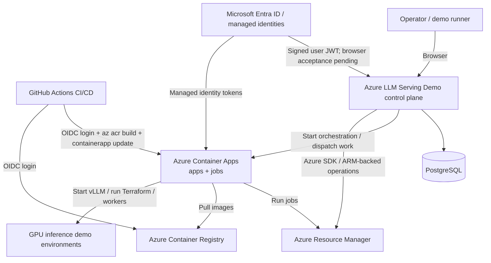

### What the system is responsible for

The system is a reusable operator-facing control plane that separates:

- **persistent control-plane concerns**: UI, API, orchestration, state, audit/telemetry, artifact storage
- **ephemeral workload concerns**: one disposable GPU-serving environment per demo environment ID

That split lets an operator keep the control plane alive while repeatedly creating and destroying demo GPU environments.

## 2. Container / component view

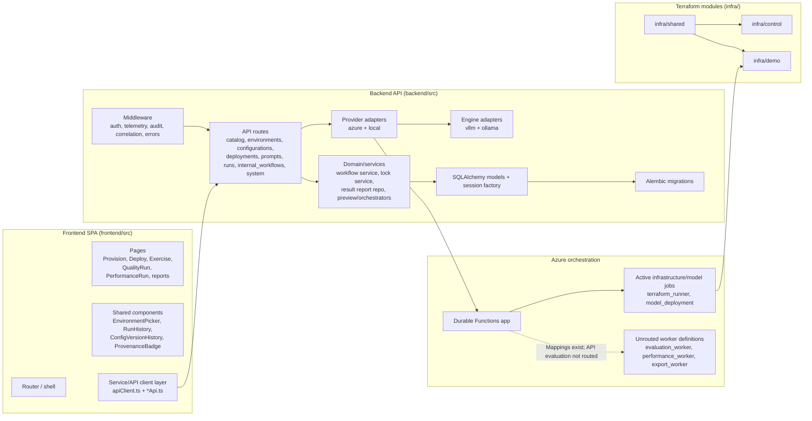

### Major components

| Component | Responsibility | Key evidence |
|---|---|---|
| Backend API layer | Exposes the control-plane HTTP surface and internal callback API | `backend/src/api/routes/__init__.py`, `backend/src/api/routes/*.py`, `backend/src/api/internal_workflows.py` |
| Backend middleware | Enforces auth, correlation, telemetry, and audit | `backend/src/api/auth.py`, `audit.py`, `telemetry.py`, `correlation.py` |
| Domain/services | Owns workflow bookkeeping, environment locking, result-report updates, and reconciliation | `backend/src/domain/orchestration_workflow_service.py`, `environment_lock.py`, `workflow_reconciliation.py`, `result_report_repo.py` |
| Provider layer | Bridges API/domain flows to Azure-backed or local execution models | `backend/src/providers/azure/adapter.py`, `backend/src/providers/local/adapter.py` |
| Engine layer | Encapsulates prompt/performance interaction with vLLM or Ollama | `backend/src/engines/vllm/adapter.py`, `backend/src/engines/ollama/adapter.py` |
| Persistence | SQLAlchemy entities plus per-request sessions | `backend/src/domain/*.py`, `backend/src/persistence/db.py` |
| Alembic | Schema-as-code for DB evolution | `backend/alembic.ini`, `backend/migrations/env.py`, `backend/migrations/versions/` |
| Frontend pages | Operator workflow screens | `frontend/src/pages/*.tsx` |
| Shared frontend components | Reusable environment/run/config UI | `frontend/src/components/EnvironmentPicker.tsx`, `RunHistory.tsx`, `ConfigVersionHistory.tsx`, `ProvenanceBadge.tsx` |
| Frontend service layer | Centralizes backend HTTP calls and request shaping | `frontend/src/services/apiClient.ts`, `catalogApi.ts`, `deploymentsApi.ts`, `environmentsApi.ts`, `runsApi.ts` |
| Durable Functions app | Starts orchestration, tracks job execution, handles cancellation | `functions/function_app.py`, `functions/orchestrators/generic_orchestrator.py`, `functions/orchestration_lib/*.py` |
| `terraform_runner` job | Applies/destroys `infra/demo`, manages per-environment and shared state blobs, works around Terraform MSI issues in Container Apps | `jobs/terraform_runner/entrypoint.py` |
| `model_deployment` job | Uses VM Run Command to start vLLM on the private GPU VM; HF credentials must not enter Terraform/history/public evidence, and cloud execution-metadata retention still needs review | `jobs/model_deployment/entrypoint.py` |
| `evaluation_worker` job | Legacy prompt-case worker; not API-routed or complete golden/benchmark/report parity | `jobs/evaluation_worker/entrypoint.py` |
| `performance_worker` job | Legacy concurrent HTTP worker; not genuine LLMPerf/TTFT/ITL parity or API-routed | `jobs/performance_worker/entrypoint.py` |
| `export_worker` job | JSON/CSV artifact worker definition; not connected to the current API reconciliation path | `jobs/export_worker/entrypoint.py` |
| `infra/shared` | Shared networking, DNS, egress, ACR, Key Vault, monitoring | `infra/shared/main.tf`, `infra/shared/providers.tf` |
| `infra/control` | Control plane: Container Apps, jobs, Functions, PostgreSQL, storage, identities, alerts | `infra/control/main.tf`, `infra/control/variables.tf` |
| `infra/demo` | Disposable per-environment GPU VM resource group | `infra/demo/main.tf`, `infra/demo/variables.tf` |

## 3. Terraform topology split

The Terraform layout is intentionally split into three layers:

| Layer | Lifetime | Why it exists |
|---|---|---|
| `infra/shared` | Rarely changed / long-lived | Keeps networking, registry, DNS, Key Vault, and monitoring stable across the whole system |
| `infra/control` | Long-lived | Hosts the operator-facing control plane and orchestration infrastructure |
| `infra/demo` | Recreated per environment | Keeps GPU-serving environments disposable and isolated per `environmentId` |

This split is explicit in `infra/README.md` and reinforced by the modules' own comments:

- `infra/control` reads `infra/shared` state
- `infra/demo` reads only `infra/shared` state and is prevented from modifying control-plane resources
- `infra/demo` is executed by `terraform_runner`, not by the operator for every single environment

The current cross-module readers use local state-file assumptions; the runner
also stores per-environment state blobs. That is not a complete protected remote
state/locking bootstrap for all layers. Defaults create/manage resource groups
and placeholder image references; they must not be applied to persistent test
groups or original resources without explicit parameterization and reviewed
state ownership. See [the Azure gap/gate guide](AZURE.md).

## 4. Runtime / flow views

## 4.1 Provision environment

Current implementation: the frontend calls the backend; the backend creates workflow records and environment locks; the Durable Functions app monitors a `terraform_runner` job; the job runs Terraform against `infra/demo` and reports the result back to the backend's internal callback API; the backend reconciles that terminal callback into `DemoEnvironment` state.

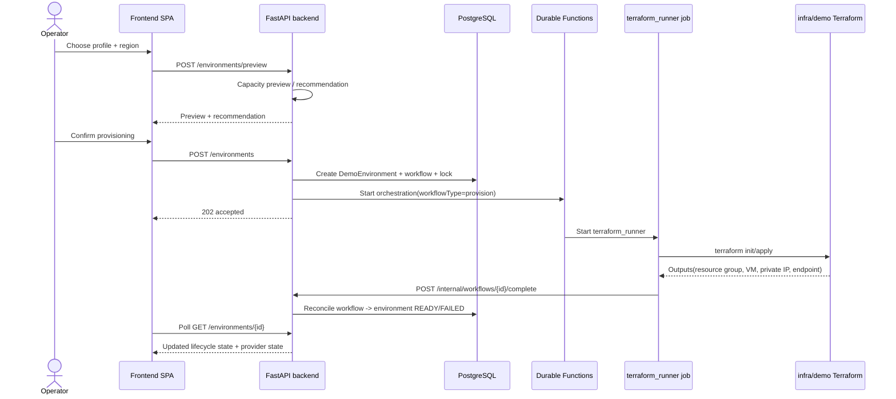

## 4.2 Deploy model

Current implementation is intentionally different from provisioning: the backend **pre-dispatches** the `model_deployment` job itself, then asks Durable Functions only to monitor the already-started job. This keeps the Hugging Face token out of Durable Functions history.

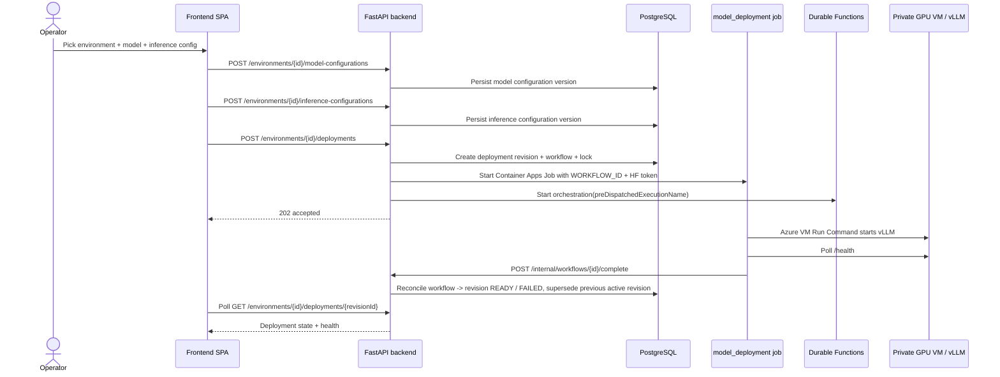

## 4.3 Exercise / prompt test

This path stays synchronous once a deployment is ready: the backend validates the environment lock state, resolves the active deployment revision, and calls the engine adapter directly.

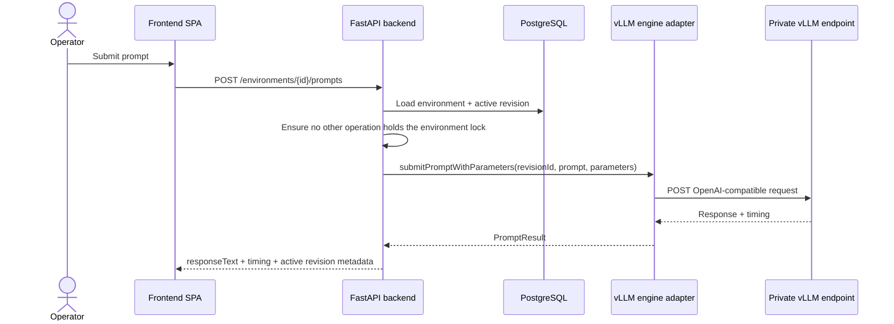

## 4.4 Quality run

As implemented today, quality runs do **not** flow through Durable Functions or `evaluation_worker`. The backend's `QualityRunOrchestrator` runs inside the backend process using a thread pool, updates `ExperimentRun` state, and writes report progress into PostgreSQL.

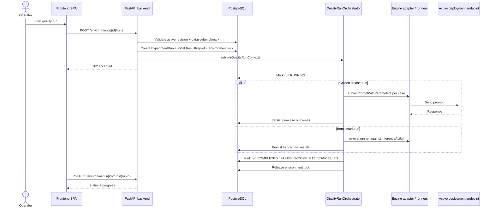

## 4.5 Performance run

Performance follows the same orchestrator pattern as quality runs today: the backend runs it in-process via the engine adapter's performance path.

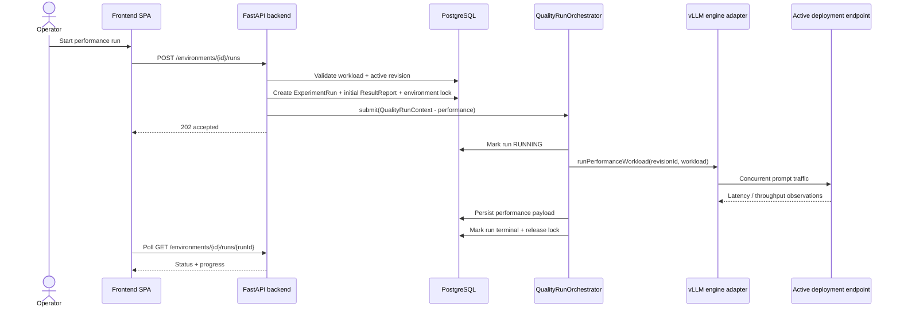

### Runtime nuance worth calling out

The repository contains:

- job implementations for `evaluation_worker`, `performance_worker`, and `export_worker`
- Functions-side workflow type mappings for `evaluate-golden`, `evaluate-benchmark`, `performance-test`, and `export`
- Terraform-managed Container Apps Job definitions for those workers

But the backend currently wires only `provision`, `teardown`, and `deploy` through the asynchronous workflow reconciliation path (`backend/src/domain/workflow_reconciliation.py` explicitly handles only those workflow types). That distinction matters when reasoning about where failures, retries, and state transitions actually happen today.

Do not remove the API's proven golden/lm-eval/genuine pinned LLMPerf paths or
set `durableEvaluation=true` until invocation, immutable snapshots, report
semantics, restart, duplicate callbacks, cancellation, stale failures and
owner-safe locks all have parity. An existing worker/Durable mapping is not
proof that API runs survive backend process loss.

### Configuration and report dataflow

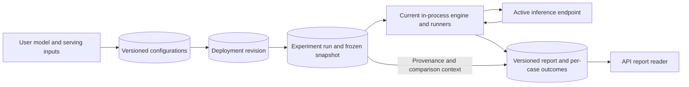

Editing a later configuration must not rewrite earlier run/report provenance.
Record exact model/artifact versions, workload, counts/failures and metric
semantics; do not make incomparable runs appear equivalent.

## 5. Deployment view

This is the intended checked-in topology, not a freshly verified Azure install.

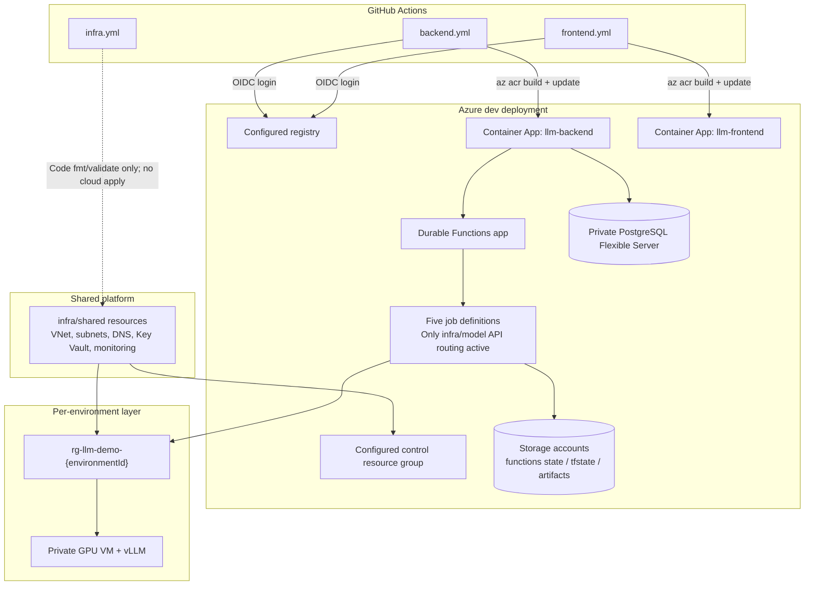

### Deployment configuration

Push and pull-request workflows run read-only checks, never cloud deployment.
Deployment requires an explicit dispatch from `main` with `deploy=true`,
repository variable `ENABLE_AZURE_DEPLOYMENT=true`, and the `azure-deployment`
environment. Resource group, registry, and app names come from that environment's
`AZURE_RESOURCE_GROUP`, `AZURE_ACR_NAME`, `AZURE_BACKEND_APP_NAME`, and
`AZURE_FRONTEND_APP_NAME` protected environment secrets. See the root README
for the explicit migration from legacy variables before enabling deployment.

## 6. Frontend structure

### Routed pages

Implemented routes are declared in `frontend/src/App.tsx` and include:

- `/provision`
- `/environments/:environmentId`
- `/deploy`
- `/exercise`
- `/quality/run`
- `/quality/report/:runId`
- `/performance/run`
- `/performance/report/:runId`

Scaffolded-but-not-yet-deeply-implemented routes currently include:

- `/retune`
- `/compare`
- `/teardown`
- `/history`

### Shared UI patterns

- `EnvironmentPicker` is reused across environment-centric pages (`Deploy`, `Exercise`, `EnvironmentDetail`, `QualityRun`, `PerformanceRun`).
- `RunHistory` is reused across both quality and performance entry pages.
- `ConfigVersionHistory` supports versioned configuration review in the deploy page.
- `Provision.tsx` stores active provisioning state in `localStorage` so the operator can recover page refreshes mid-provisioning.

## 7. Backend structure

### API surface

The FastAPI router composes these route groups:

- `system`
- `catalog`
- `environments`
- `configurations`
- `deployments`
- `prompts`
- `runs`
- `internal_workflows`

The backend app composition root wires:

- request authentication
- telemetry capture
- audit logging
- optional CORS
- session factory
- provider/engine integrations

### Persistence model

The backend uses:

- SQLAlchemy declarative models in `backend/src/domain/`
- session creation in `backend/src/persistence/db.py`
- Alembic configuration in `backend/alembic.ini` and `backend/migrations/env.py`

### Auth split

There are two different auth paths:

1. **operator-facing cloud requests** require a cryptographically validated RS256 Entra user JWT with correct issuer, audience, timestamps, explicit operator tenant and allowed domain. Unsigned name/demo headers are not identities. The production frontend uses a same-origin nginx proxy to transport an actual platform ID token as bearer authorization; token contents are still verified.
2. **internal callbacks** use managed-identity bearer token validation in `backend/src/api/internal_auth.py`

That keeps browser/session auth separate from service-to-service orchestration
auth. Explicit `local-demo` is development-only and forbidden in production/
Azure hosting. Real Entra/browser token transport remains unverified; see
[authentication](AUTHENTICATION.md).

### Cloud authentication contract (live browser acceptance pending)

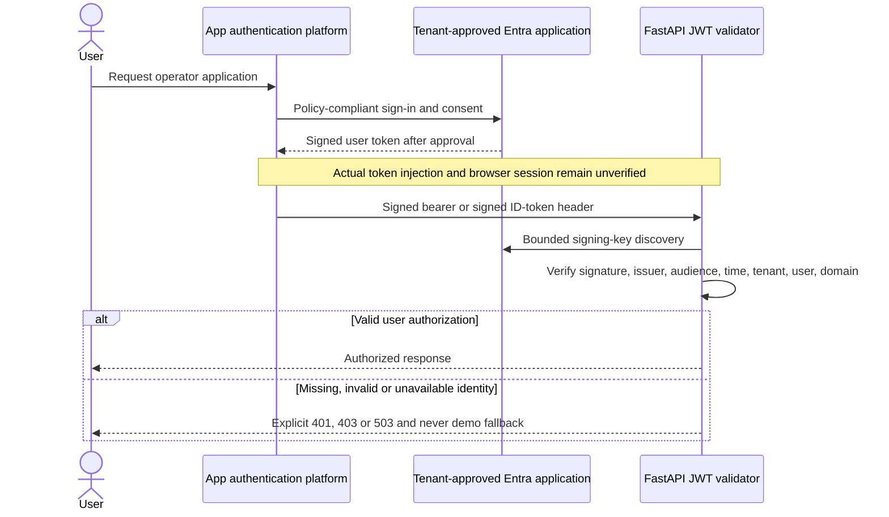

### Protected OIDC and independent canary cleanup

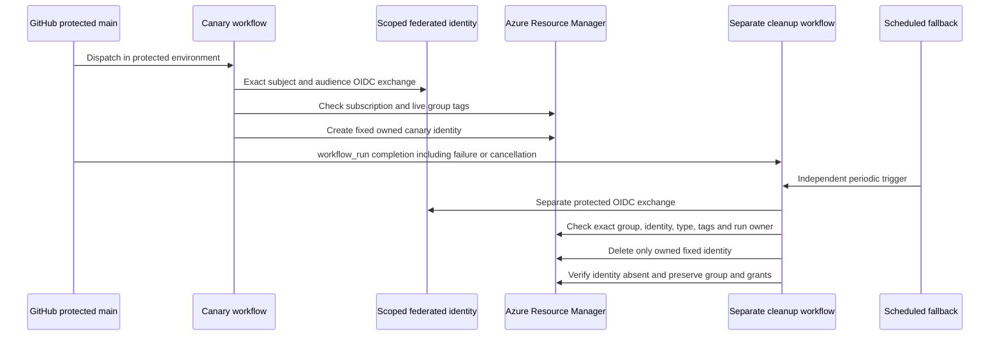

The [actual failure/cancellation runs](AZURE_CANARY.md) prove this identity-only
contract. Independent cleanup for billable resources is a separate unmet gate.

### Persisted environment lifecycle (common paths)

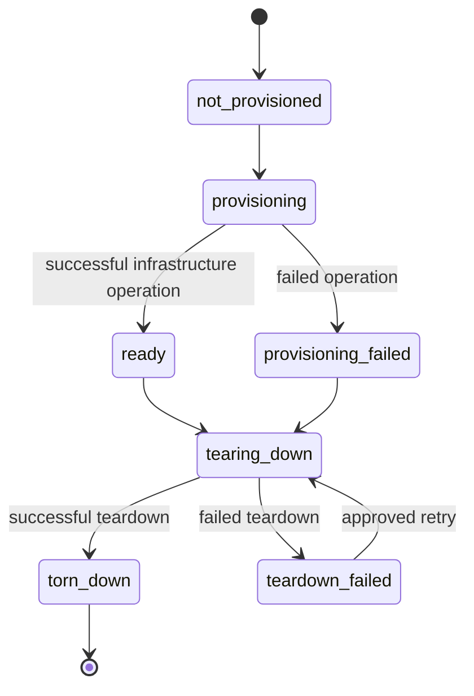

These are persisted lifecycle labels, not live power/model health. Deployment
revisions and experiment runs have separate state machines; a `ready` environment
does not prove a running GPU, a warm model or a complete report. Unknown lookup,
quota visibility, DB pause, VM deallocation and cold-start behavior must remain
visible rather than silently promoting state. See [operations](OPERATIONS.md).

## 8. Architecture Patterns & Design Principles Applied

Only patterns directly evidenced in this repo are included below.

| Pattern / principle | Where it is applied | Why it fits here |
|---|---|---|
| Layered application structure | API routes in `backend/src/api/routes/`; orchestration/domain logic in `backend/src/domain/` and `backend/src/evaluation/`; persistence in `backend/src/persistence/db.py`; provider/engine integrations in `backend/src/providers/` and `backend/src/engines/` | The demo has to mix HTTP control-plane concerns, domain state transitions, DB persistence, and Azure-specific integration work. The separation makes it easier to change Azure orchestration details without rewriting route handlers or entity models. |
| Adapter-based provider and engine abstraction | `backend/src/providers/base.py`, `backend/src/providers/azure/adapter.py`, `backend/src/providers/local/adapter.py`, `backend/src/engines/base.py`, `backend/src/engines/vllm/adapter.py`, `backend/src/engines/ollama/adapter.py` | The app supports both Azure-hosted vLLM and a local Ollama mode. Adapter boundaries let the same UI/API workflow run against different environment and inference backends. |
| Single-writer environment locking | `backend/src/domain/environment_lock.py`; usage in `backend/src/api/routes/deployments.py`, `backend/src/api/routes/prompts.py`, and `backend/src/api/routes/runs.py` | Provisioning, deployment, prompt submission, and run execution all compete for the same environment. A dedicated lock service prevents overlapping operations that would otherwise corrupt state or target a half-deployed endpoint. |
| Callback-driven asynchronous reconciliation | Workflow bookkeeping in `backend/src/domain/orchestration_workflow_service.py`; callback API in `backend/src/api/internal_workflows.py`; terminal reconciliation in `backend/src/domain/workflow_reconciliation.py`; orchestration start in `backend/src/providers/azure/provision.py` and `deploy.py` | Long-running Azure work should not block the HTTP request thread. The backend records intent, hands execution off, and changes environment/deployment state only when the callback arrives, which matches the latency and failure model of Terraform and VM bootstrapping. |
| Control-plane vs. workload-plane infrastructure separation | `infra/shared`, `infra/control`, and `infra/demo`, especially `infra/README.md`, `infra/control/main.tf`, `infra/demo/main.tf` | The control plane must be stable and long-lived, while demo GPU environments are intentionally disposable. Splitting the Terraform modules minimizes blast radius and lets demo environments be torn down without touching the operator app. |
| Infrastructure as Code | All Terraform under `infra/`; validation in `.github/workflows/infra.yml` | The app provisions non-trivial Azure topology: network, identities, storage, Container Apps, Functions, PostgreSQL, and GPU VMs. Capturing that in Terraform makes the demo reproducible and reviewable. |
| Traceable per-commit image tags | Git-SHA tags in `.github/workflows/backend.yml` and `.github/workflows/frontend.yml` | Tags aid tracing but can be overwritten; digest pinning/provenance is still required for immutable release/rollback claims. |
| OIDC federated CI/CD auth instead of stored long-lived credentials | Commit-pinned Azure login actions in `.github/workflows/backend.yml` and `.github/workflows/frontend.yml` | OIDC avoids stored cloud credentials. Nonsecret infrastructure IDs use protected environment secrets for pre-step log masking; that does not broaden access or certify an unattended release. |
| Schema-as-code migrations | `backend/alembic.ini`, `backend/migrations/env.py`, `backend/migrations/versions/` | The backend persists workflow state, catalog entries, deployments, and result reports. Alembic provides an auditable way to evolve that schema across environments. |
| Shared-component reuse in the frontend | `frontend/src/components/EnvironmentPicker.tsx`, `RunHistory.tsx`, `ConfigVersionHistory.tsx`; reused across pages per `frontend/src/pages/*.tsx` imports | The same environment selection and history views appear across multiple operator tasks. Reusing them keeps the workflow consistent and avoids duplicating logic/UI markup. |
| UX resilience through local browser persistence | `frontend/src/pages/Provision.tsx` uses `window.localStorage` under `llmDemo.activeProvisioning` | Provisioning is asynchronous and can outlive a tab refresh. Persisting the in-flight state lets the operator recover context instead of restarting the workflow. |
| Contract-oriented backend test organization | `backend/tests/contract/test_provider_interface.py`, `test_environments_create.py`, `test_internal_workflow_api.py` | This system has several seams: provider adapters, internal orchestration callbacks, and API payloads. Contract tests make those boundaries explicit and help keep async orchestration behavior stable during refactors. |
| Spec-driven delivery artifacts | `specs/001-llm-serving-demo/spec.md`, `plan.md`, `research.md`, `tasks.md` | The repo includes first-class feature specs and architecture planning artifacts alongside implementation. For a demo platform with many moving parts, that helps keep the product story, architecture intent, and implementation work aligned. |

## 9. What to read next

- [`../README.md`](../README.md) - operator-level project overview and setup
- [`../backend/README.md`](../backend/README.md) - backend local setup and validation
- [`../frontend/README.md`](../frontend/README.md) - frontend dev workflow
- [`../infra/README.md`](../infra/README.md) - Terraform bring-up order and isolation model
- [`../specs/001-llm-serving-demo/`](../specs/001-llm-serving-demo/) - spec-kit feature artifacts
