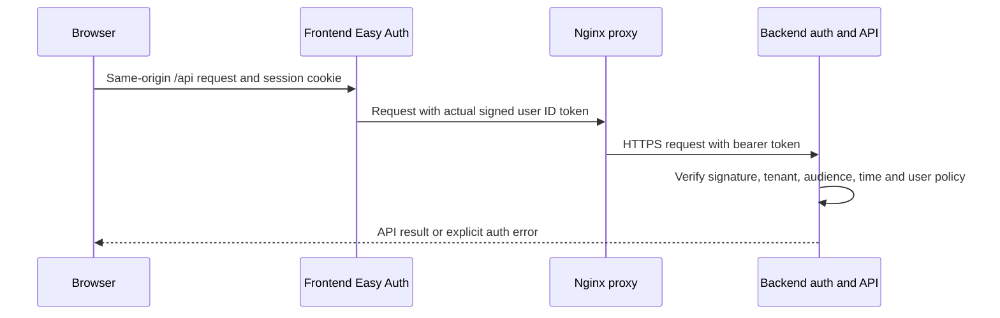

# Authentication and external SSO bootstrap

## Trust boundaries

`AUTH_MODE=entra-jwt` is the backend's safe default. Cloud Terraform sets this
mode and `APP_ENV=production` explicitly. Browser/operator requests require a
cryptographically validated RS256 Entra user token with the configured tenant
issuer, audience, expiry/issued-at, tenant ID and user identity. The allowed
email-domain list remains enforced. Caller-supplied `X-Demo-User`,
`X-User-Email`, `X-Forwarded-Email` and `X-MS-CLIENT-PRINCIPAL-NAME` cannot
authenticate cloud requests. A real bearer token or Easy Auth's signed
`X-MS-TOKEN-AAD-ID-TOKEN` can; the header name alone is not trusted.

Missing tenant/audience fails closed with `operator_auth_unconfigured` (503).
Invalid/missing tokens return 401; forbidden domains return 403. Service tokens
cannot impersonate operators merely by supplying a username header. Internal
workflow callbacks still use their separate audience-restricted managed-identity
validator.

Signing-key discovery has a five-second network timeout; synchronous signature
validation/discovery runs off the API event loop so it cannot block liveness
probes. Operator key-discovery connection failures return the explicit
`identity_provider_unavailable` 503, not a demo fallback.

`AUTH_MODE=local-demo` is an explicit local development opt-in that preserves
the original demo workflow. It is rejected for production and Azure Container
Apps/App Service hosting. Tests opt into local-demo explicitly; separate tests
exercise real signed-token validation and cloud rejection of every legacy
identity header.

## Browser-to-API transport

Production browser requests use same-origin `/api`. Nginx receives the actual
platform `X-MS-TOKEN-AAD-ID-TOKEN`, forwards it as bearer authorization to the
runtime `BACKEND_URL`, and strips unsigned identity headers. An explicit bearer
token is preserved when there is no platform ID-token header. The proxy does
not validate or trust a header as an identity: the backend performs the complete
JWT validation above, and upstream TLS certificate verification remains enabled.
Missing credentials return 401, never a demo user.

The platform must actually supply a user ID token for this path. Its availability
and any tenant-approved token-store configuration must be verified in the target
Container Apps deployment. An absent token is a blocked authentication flow,
not permission to substitute principal-name headers or disable either layer's
authentication. Tokens are not copied into browser storage or frontend logs.

Real-image tests cover synthetic header/path transport and missing-token
rejection; backend tests cover locally signed JWT validation. Neither substitutes
for an actual Entra browser session, which remains unverified until bootstrap.
Local Vite development still uses its explicit `VITE_API_BASE_URL`; cloud builds
must use the runtime same-origin proxy rather than a baked cross-origin API URL.

## Two supported infrastructure inputs

The original default `enable_sso=true` manages a new app registration, service
principal and credential through Terraform's AzureAD provider. This needs an
authorized tenant directory identity, and its credential is sensitive Terraform
state. Use protected remote state and private Key Vault access; do not broaden a
scoped Actions managed identity's Graph permissions to make this work.

Alternatively, a tenant-approved operator can bootstrap a **new isolated**
validation app outside Terraform and supply:

| Input | Exact requirement |
| --- | --- |
| Tenant | The same tenant as the deployment subscription and backend token issuer |
| `existing_sso_client_id` | The new Entra application client UUID, not the existing application's identity |
| `existing_sso_secret_id` | A versionless `https://<isolated-shared-vault>.vault.azure.net/secrets/<name>` credential reference, never its secret value |
| Redirects | `https://<new-frontend-fqdn>/.auth/login/aad/callback` and `https://<new-backend-fqdn>/.auth/login/aad/callback` |
| Identity policy | Tenant-approved users/assignments/consent and explicit allowed email domains |

Supply both external inputs or neither. External mode does not create an
AzureAD application, service principal, password or Key Vault secret through
Terraform; it still configures Easy Auth using the supplied references. The
secret must reside in the isolated shared layer's vault, where only the
application managed identities' existing narrowly scoped Secrets User access
applies. An operator must write/rotate it over approved private connectivity.
Do not pass the credential value in GitHub variables, CLI arguments, tfvars,
state uploads, logs, screenshots or chat.

Disabling Easy Auth does not disable backend JWT validation and is not a
bootstrap workaround. Cloud plan preconditions require an authentication
application and validate external input pairing/vault scope. External mode
avoids Graph application writes, but actual provider initialization, consent,
Easy Auth token forwarding and browser sign-in must still be verified in the
target tenant; static Terraform validation is not proof of those operations.

## What remains a real release gate

ARM Contributor/RBAC roles, Actions OIDC and a successful cleanup canary do not
grant Graph consent or establish an interactive application session. If a
tenant policy denies sign-in or the operator lacks app-registration permission,
record authenticated Azure UX as **blocked**. Do not retry around Conditional
Access, reuse the original app, grant the managed identity broad Graph rights,
or expose the API with demo headers.

Actual authenticated frontend-to-backend requests, token/cookie forwarding,
CORS, negative authorization paths and teardown must be tested after bootstrap.
The current external-bootstrap code and local signed-token tests do not claim
that this cloud browser flow has passed. No GPU expenditure should be incurred
before real authentication, independent billable-resource cleanup and the
aggregate budget/exposure gate are established.
