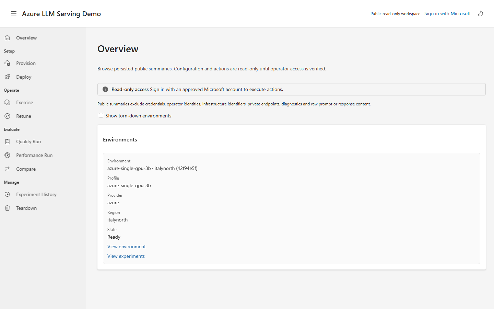
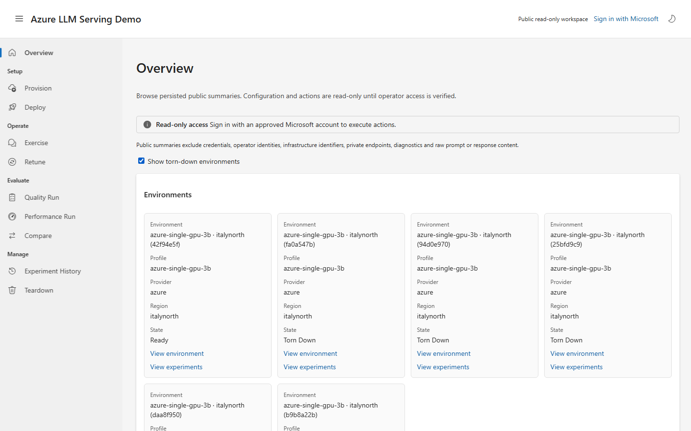
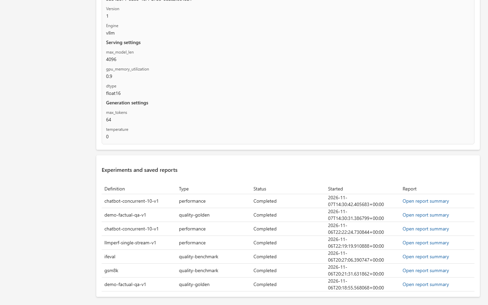
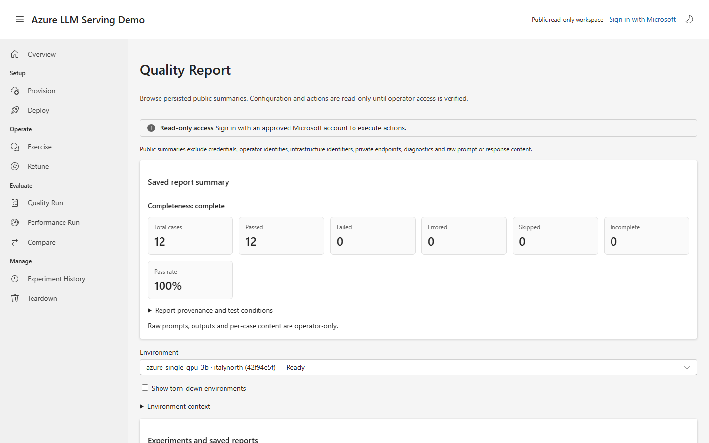
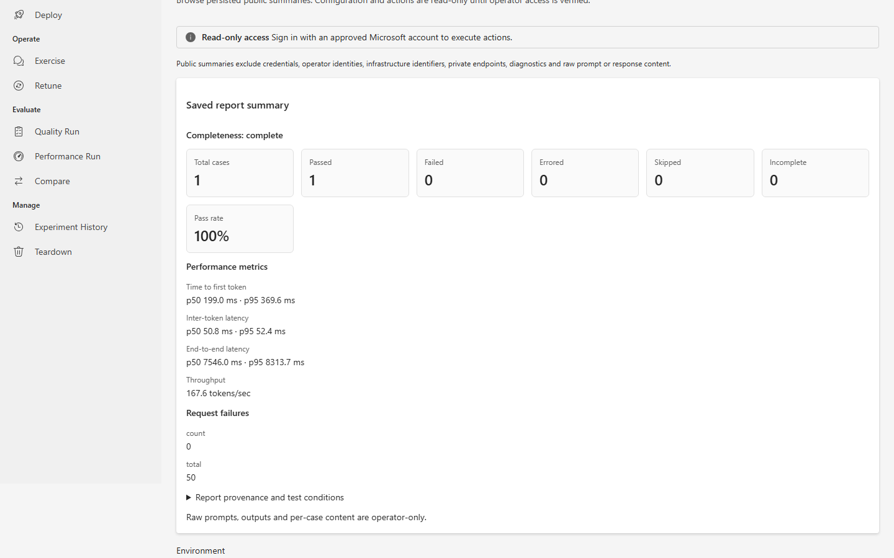

# Serving Lab user guide

[Documentation index](README.md) · [Demo walkthrough](DEMO.md) ·
[Interpreting results](DEMO.md#interpreting-results)

Serving Lab helps you browse persisted experiment results and, if you are an
authorized operator, manage an LLM serving environment. Open the
[public demo](https://servinglab.liberatetheinnerchild.net); a visitor account is
not required to browse its sanitized summaries.

## Access and navigation

The navigation groups the workflow into **Setup**, **Operate**, **Evaluate**, and
**Manage**. On a narrow screen, open the navigation menu in the header. The
header also contains the light/dark theme control and **Sign in with Microsoft**.
Sign-in returns you to the current route.

Public visitors can inspect saved environment state, configurations, definitions,
experiment summaries and saved comparisons. Public reports omit raw prompts,
outputs, individual case content, private endpoints and operator identities.
Public browsing does not run inference or wake an environment. Disabled actions
are intentional. An identity-provider problem does not prevent public reads;
if public data itself fails to load, use its retry control.

An approved operator sees the forms and controls described below after signing
in. Availability depends on environment state and authorization; a disabled
control is not a substitute for backend access checks. Creating or deploying
cloud resources can incur charges. Use an authorized target and follow the
[operator prerequisites](OPERATOR_CONFIGURATION.md) before making changes.

## Find an environment

On **Overview**, select an environment or follow **View experiments**. Elsewhere,
use the **Environment** selector. It shows environments that are not torn down
first; select **Show torn-down environments** to browse the rest. An explicitly
selected torn-down environment remains selected when you reopen its history or
report. A failed environment is not classified as torn down.

When no saved human-readable name is available, the selector uses the profile,
region and a short ID to distinguish entries. The optional name entered during
provisioning is not currently persisted as a display name. If no active
environments exist, enable the torn-down option to inspect retained history.

**Environment detail** shows lifecycle, profile and region. Operators can also
inspect available capacity, resource and cost context; public detail contains
only the sanitized projection. Persisted lifecycle state is not a live health
check or proof that a model is warm.

## Browse runs and reports

Choose **Experiment History**, select an environment and open a run's report.
Public history presents a compact table; operators can also reopen the run page
or export report JSON. Operator exports may contain raw case content and
private provenance: handle them as sensitive data, not public screenshots.

### Quality

The **Quality report** starts with aggregate counts and pass rate. Read passed,
failed, errored, skipped and incomplete counts together with the completeness
indicator. Benchmark results include score, baseline, delta and regression
status when recorded.

Operators can filter deterministic cases and expand **View case** to inspect
the input, evaluation rule and observed outcome. **Report provenance** reveals
the report and configuration context. Public reports show safe aggregates and
benchmark summaries, not individual cases.

### Performance

The **Performance report** puts available latency distributions, throughput
and request failures before secondary details. Expand **Test conditions and
provenance** for workload settings, reference information and operator
accelerator details when available. Public reports use the corresponding
**Report provenance and test conditions** disclosure.

Latency values include their units; throughput is in tokens per second. A
partial or missing measurement is not a zero or a successful result. A
configured warm-up is not evidence that warm-up actually ran. See
[metric interpretation](DEMO.md#interpreting-results) for TTFT, inter-token
latency, throughput, completeness and comparison caveats.

### Compare

Visitors can open an existing saved comparison from **Compare**. Operators can
enter two or more **Result report IDs**, optionally enter a title, add or remove
report rows and select **Compare**. Use report IDs from report provenance, not
run IDs. Check the comparability status and reasons before interpreting deltas.
The generated comparison URL can be reopened later.

## Operator workflow

The following describes the operator interface; public visitors see read-only
summaries instead of these submission forms.

1. **Provision.** Choose a deployment profile, compatible model, region and
   any profile inputs. Select **Preview region recommendation**, inspect quota,
   capacity and uncertainty, then confirm provisioning only for the intended
   target. Changing the region or profile inputs after a preview requires a
   fresh preview. Azure provisioning can create billable resources; local
   provisioning uses the configured local runtime.
2. **Deploy.** Select an environment, create or select model and inference
   configuration versions, then explicitly deploy the selected versions.
   Saving a configuration alone does not change traffic. A gated checkpoint
   may require a Hugging Face token; do not share or capture it. Monitor the
   deployment's lifecycle and health.
3. **Exercise.** Select the environment, enter a prompt and optional parameters
   JSON, and send the prompt. Inspect the response, deployment revision and
   timing. Prompt history is session-only and clears on refresh or close.
4. **Quality Run.** Choose a golden dataset or benchmark definition, start a
   run, monitor progress and diagnostics, and open the report when available.
   Eligible in-progress runs can be cancelled; prior reports remain accessible
   from run history.
5. **Performance Run.** Choose a workload, start and monitor the run, then open
   its report. Cancellation and history controls follow the same pattern.
   Interpret failures and completeness before comparing results.
6. **Retune.** Load an environment with an active deployment, review its
   current settings and, if useful, choose an earlier configuration version.
   Revise inference settings and select **Create new inference version and
   redeploy**. This creates a version and starts a deployment; it is not merely
   a preview.
7. **Teardown.** Select the intended environment and choose whether to retain or
   export artifacts. Generate and inspect the resource-impact preview. Only
   then type the exact accepted confirmation and execute teardown if authorized.
   Changing the environment or preservation mode requires a new preview.
   Teardown is destructive; retained reports can still be opened from history.

For a disposable local exercise, use the
[local operator walkthrough](DEMO.md#local-operator-walkthrough). Never perform
a live preview, deployment, inference run or teardown solely to produce guide
screenshots.

## Public screenshot reference

These are **live public read-only captures**, taken 2026-11-08 after the
frontend-only rollout. The deployed frontend revision was
`llmrelease-frontend--0000005`, built from source
`84e32ef148833d49b24215072676fac9b9aa01e7`; its image digest was
`sha256:237b01011c568048a0989301f02e86c74e49410b7cad7fbd3fde8f02c1e7028a`.
Results and available environments are point-in-time observations, not current
health guarantees or performance promises. These screenshots do not document
operator-only forms or prove authenticated actions.

| Screen | Public capture |
| --- | --- |
| Overview and archive selection | [Overview](images/user-guide/overview.png), [torn-down environments](images/user-guide/overview-archived.png) |
| Provision and environment detail | [Provision](images/user-guide/provision.png), [environment selection](images/user-guide/environment-picker.png), [environment detail](images/user-guide/environment.png) |
| Deployment and exercise | [Deploy](images/user-guide/deploy.png), [Exercise](images/user-guide/exercise.png), [Retune](images/user-guide/retune.png) |
| Quality | [Quality Run](images/user-guide/quality-run.png), [quality report](images/user-guide/quality-report.png) |
| Performance | [Performance Run](images/user-guide/performance-run.png), [performance report](images/user-guide/performance-report.png), [metrics and failures](images/user-guide/performance-metrics.png), [mobile report](images/user-guide/performance-report-mobile.png) |
| Compare and history | [Compare](images/user-guide/compare.png), [history](images/user-guide/history.png), [history table](images/user-guide/history-table.png), [selected torn-down history](images/user-guide/archived-history.png) |
| Teardown | [Teardown](images/user-guide/teardown.png) |
