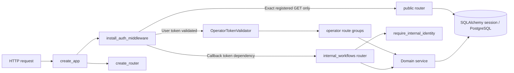
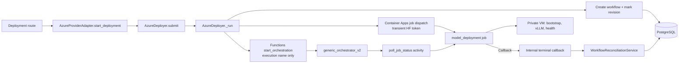
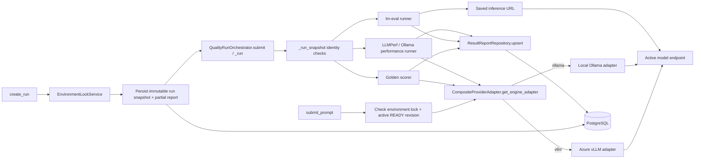

# C4 L4 — Selected code views

[Architecture map](../ARCHITECTURE.md) /
[L1 context and L2 containers](CONTEXT.md) /
[L3 components](COMPONENTS.md) /
[dynamic flows](FLOWS.md)

L4 is a zoom lens, not a fourth kind of runtime box. These diagrams show
selected real functions/classes and their calls so a reader can follow important
contracts from HTTP entry to side effect and back. They intentionally omit
ordinary helpers, UI details and most files; source links are the authority.
Solid arrows are the implemented call/data handoff. Dashed arrows mark
alternative or monitored paths. A sequence diagram in [FLOWS](FLOWS.md) adds
time ordering and failure branches.

## 1. Request composition and identity

`create_app` installs cross-cutting middleware and composes route groups.
`install_auth_middleware` exempts only full matches for registered public GET
routes; it does not make arbitrary `/public`-looking paths public. Public
projections read persisted data and never invoke provider/engine actions.
Operator JWT verification and internal managed-identity verification have
separate validators, audiences and route dependencies. UI gating and Nginx
header stripping are defense-in-depth; authorization and field allowlisting
remain server-side.

Sources: [`app.py`](../../backend/src/api/app.py),
[`routes/__init__.py`](../../backend/src/api/routes/__init__.py),
[`auth.py`](../../backend/src/api/auth.py),
[`public.py`](../../backend/src/api/routes/public.py),
[`internal_auth.py`](../../backend/src/api/internal_auth.py),
[`internal_workflows.py`](../../backend/src/api/internal_workflows.py).

## 2. Provisioning: persisted intent to reconciled environment

```mermaid
flowchart LR
    Route["create_environment"]
    Lock["EnvironmentLockService.acquire"]
    Commit["Commit accepted environment + lock"]
    Adapter["AzureProviderAdapter.start_provisioning"]
    Submit["AzureProvisioner.submit"]
    Run["AzureProvisioner._run"]
    Starter["Functions http_start"]
    Orch["generic_orchestrator_v2"]
    Dispatch["dispatch_job activity"]
    Worker["terraform_runner.run"]
    Lease["_remote_state_lock: acquire/hold"]
    Terraform["_run_terraform<br/>inside lease-held scope"]
    JobControl["Container Apps Jobs control API"]
    ARM["Azure Resource Manager"]
    Callback["complete_workflow"]
    Reconcile["WorkflowReconciliationService.reconcile"]
    Finalize["finalize_workflow activity"]
    DB[("PostgreSQL")]
    Route --> Lock --> Commit --> DB
    Commit --> Adapter --> Submit --> Run
    Run --> Starter --> Orch --> Dispatch --> Worker
    Worker --> Lease
    Worker --> Terraform
    Terraform --> ARM
    Lease --> Blob[("Private state Blob")]
    Worker -->|Authenticated terminal callback| Callback
    Callback --> Reconcile --> DB
    Orch -->|Poll status / stop| JobControl
    JobControl -->|Manage execution| Worker
    Orch -->|Crash-safety finalization| Finalize --> Callback
```

The route validates the preview, creates a provisioning environment record,
acquires its DB single-writer lock and commits **before** it submits background
work. `AzureProvisioner` then starts a process-local thread that starts Durable
Functions. Provision and teardown use the Functions activity to dispatch the
Terraform job. The worker writes a private attempt record and acquires the
exclusive state Blob lease before mutation. The job reports terminal status to
the internal API; `complete_workflow` and `WorkflowReconciliationService`
update workflow and owned domain state in one database transaction.

This separation prevents “ARM says a VM exists” from becoming “the application
record says READY” without a validated callback. An uncertain Terraform
mutation or failed state upload retains recovery evidence/lease; it is not a
safe blind retry. The DB environment lock serializes API operations, while the
Blob lease serializes cooperating Terraform workers. They protect different
resources and neither substitutes for the other.

Sources: [`create_environment`](../../backend/src/api/routes/environments.py),
[`AzureProviderAdapter`](../../backend/src/providers/azure/adapter.py),
[`AzureProvisioner`](../../backend/src/providers/azure/provision.py),
[`Functions starter`](../../functions/function_app.py),
[`orchestrator`](../../functions/orchestrators/generic_orchestrator.py),
[`activities`](../../functions/activities/activities.py),
[`Terraform runner`](../../jobs/terraform_runner/entrypoint.py),
[`callback`](../../backend/src/api/internal_workflows.py),
[`reconciliation`](../../backend/src/domain/workflow_reconciliation.py),
[`lock protocol`](../TERRAFORM_STATE.md).

## 3. Deployment: secret-safe pre-dispatch and durable monitoring

Deployment intentionally differs from provision/teardown dispatch. `AzureDeployer`
pre-dispatches the model job from the API-side worker, carrying the gated-model
token only in that transient call. It starts the Durable Functions monitor with
the job execution name, not the credential; the Functions host polls and handles
cancellation/timeout. The job applies the chosen checkpoint and serving settings,
waits for VM bootstrap and checks model health before reporting terminal state.

This design limits where a credential can be copied into replayable workflow
history, but the API-side thread-pool handoff is not a durable queue and does not
establish exactly-once dispatch or automatic restart recovery. Credential
redaction, downstream command metadata retention and job/provider retention
remain separate operational concerns; never dump raw credential-bearing SDK
requests to diagnose a failure.

Sources: [`deployment route`](../../backend/src/api/routes/deployments.py),
[`AzureProviderAdapter`](../../backend/src/providers/azure/adapter.py),
[`AzureDeployer`](../../backend/src/providers/azure/deploy.py),
[`Functions monitor`](../../functions/orchestrators/generic_orchestrator.py),
[`model deployment job`](../../jobs/model_deployment/entrypoint.py),
[`workflow callback`](../../backend/src/api/internal_workflows.py).

## 4. Inference, evaluation and report persistence

Interactive inference rejects a busy environment or missing/non-READY active
revision before choosing an engine. The composite provider registry currently
routes vLLM to the Azure adapter and Ollama to local; the engine adapter sends
the request and normalizes its response. This is a real inference path, not a
public anonymous endpoint.

Quality/performance acceptance is a different lifecycle. `create_run` resolves
the current environment/revision and definition, acquires the environment lock,
deep-copies accepted configuration and definition into the run snapshot, creates
the partial report, commits, then submits a `QualityRunOrchestrator` future.
`_run_snapshot` verifies that the worker's context still matches those persisted
identities before using the frozen cases/workload. Golden scoring, benchmark
evaluation and performance measurement use their respective runners and update
the report through `ResultReportRepository`. Golden and performance requests
obtain an engine adapter; benchmark evaluation sends requests through lm-eval
using the saved inference API URL directly. The shared endpoint is not evidence
that these are the same call path.

The report/snapshot are durable database rows; the future and cooperative cancel
event are in-process memory. If the API process is lost, the saved record remains
but automatic orphan recovery, exactly-once execution and cross-replica
cancellation are not established. Do not equate persisted progress with a
recoverable worker.

Sources: [`prompt route`](../../backend/src/api/routes/prompts.py),
[`provider/engine selection`](../../backend/src/providers/registry.py),
[`engine protocol`](../../backend/src/engines/base.py),
[`vLLM adapter`](../../backend/src/engines/vllm/adapter.py),
[`Ollama adapter`](../../backend/src/engines/ollama/adapter.py),
[`run acceptance`](../../backend/src/api/routes/runs.py),
[`run executor`](../../backend/src/evaluation/run_quality.py),
[`report repository`](../../backend/src/domain/result_report_repo.py),
[`lock service`](../../backend/src/domain/environment_lock.py).

## Further reading

- [C4 level boundaries and diagram legend](../ARCHITECTURE.md#how-to-read-these-diagrams)
- [L3 components](COMPONENTS.md)
- [Provisioning, deployment, inference and run sequences](FLOWS.md)
- [Deployment topology, provenance and recovery boundaries](DEPLOYMENT.md)
- [Provider extension roadmap](../PROVIDER_EXTENSION.md)
