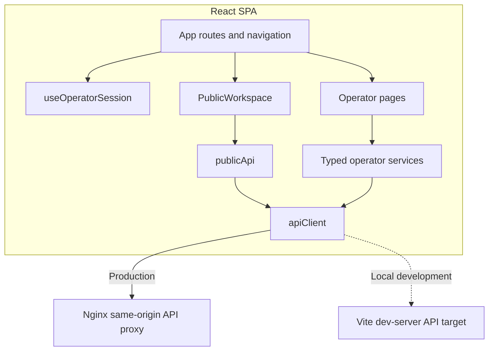
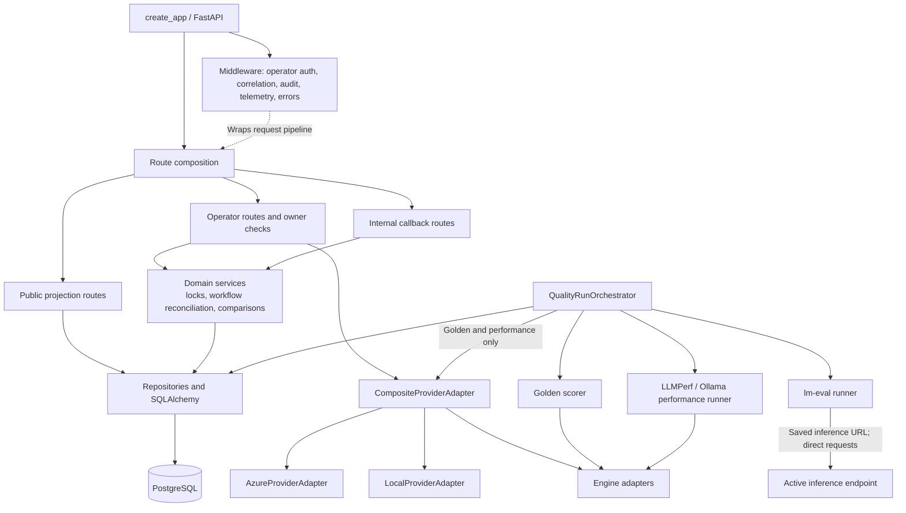
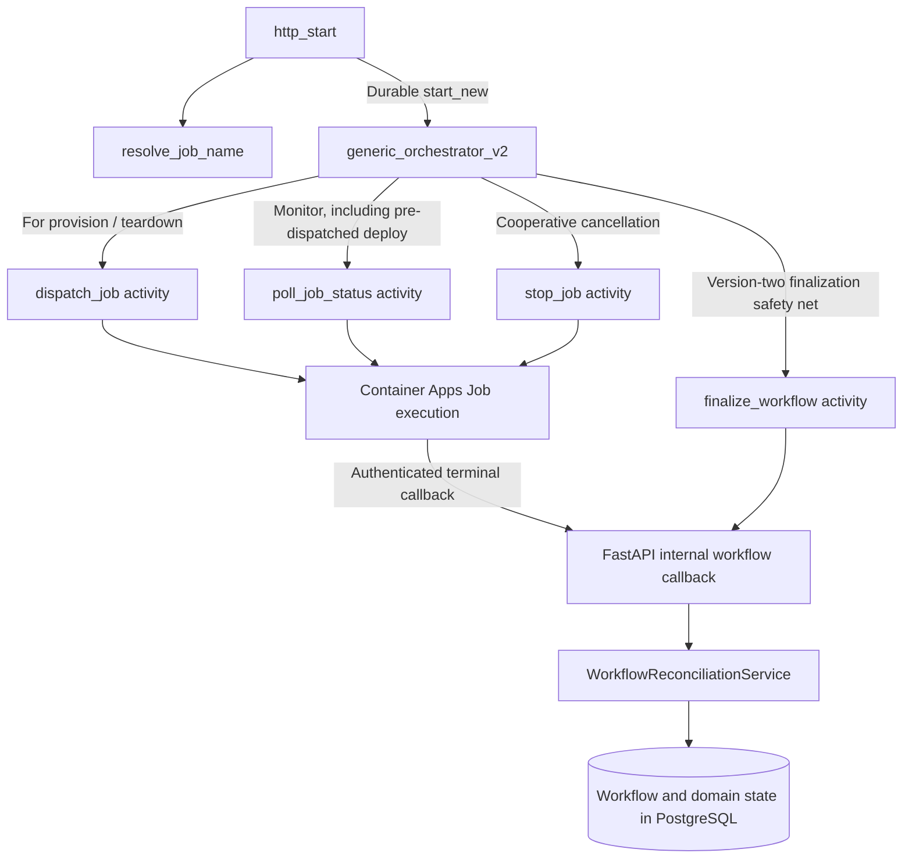
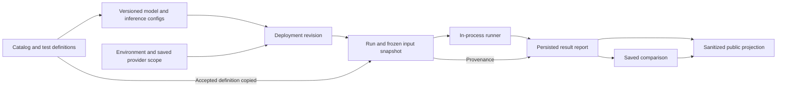

# C4 L3 — Components and data lineage

[Architecture map](../ARCHITECTURE.md) / **depth 3** /
[L2 containers](CONTEXT.md#c4-level-2-runtime-containers) / [L4 code](CODE.md) /
[deployment](DEPLOYMENT.md) / [dynamic flows](FLOWS.md)

L3 diagrams take **one L2 container at a time** and explain its logical
components. Arrows are source relationships, not a timeline. Solid arrows show
implemented paths; dashed arrows are labeled as an alternative transport or a
cross-cutting relationship. The API's middleware wraps routing; it does not
forward a request to every router in turn. Use the [sequence views](FLOWS.md)
to understand order, async handoffs and failure behavior. These views expand the
key coordination containers, not every L2 container: PostgreSQL and storage
internals are better explained by their data and deployment contracts than by
invented application components.

## React UI / Nginx components

[`App.tsx`](../../frontend/src/App.tsx) is the route shell. It renders
[`PublicWorkspace`](../../frontend/src/pages/PublicWorkspace.tsx) while signed
out and gates operator routes with `OperatorAccess` after
[`useOperatorSession`](../../frontend/src/services/useOperatorSession.ts)
verifies `/session`. `PublicWorkspace` reads safe saved profiles/catalog,
environments, configurations, definitions, runs, reports and comparisons; it
does not submit actions. `publicApi` and typed operator services both use
[`apiClient`](../../frontend/src/services/apiClient.ts), but different request
functions do not create an authorization boundary: Nginx and the backend enforce
the public/operator distinction.

Operator pages implement Provision, Deploy, Exercise, Retune,
Quality/Performance Run and Report, Compare, Experiment History, Environment
Detail and Teardown. Saving a tuning version does not change traffic; deployment
creates a new revision. Exercise history is session-only. Public data failures
and sign-in unavailability have distinct retry/error states.

## FastAPI control-plane components

The app's router composition is the HTTP entry surface; middleware runs around
that surface for applicable requests. Route groups divide public read-only
projection, user/operator actions and machine-to-machine callbacks. Domain
services implement state transitions, lock ownership and reconciliation.
Repositories persist state. The provider adapter controls environment lifecycle
and selects an engine adapter. Interactive prompts, golden scoring and
performance runs use that engine adapter; benchmark evaluation instead sends
requests through lm-eval using the saved inference URL. Similar names do not
mean these paths are interchangeable: provider selection answers *where is the
environment?*; engine selection answers *how do I talk to its model?*

Azure preflight checks the exact effective SKU/region/priority without claiming
physical capacity. Azure and local adapters share a protocol, not infrastructure
implementations. The composite registry selects supported Azure or local
providers; vLLM is currently routed to Azure and Ollama to local. This is why a
new cloud adapter alone would not enable cloud vLLM.

[`public.py`](../../backend/src/api/routes/public.py) allowlists finite metrics
and tuning fields; it removes raw text, checkpoints, arbitrary arguments, URLs,
diagnostics and infrastructure identities. It never calls provider/engine
operations. [`auth.py`](../../backend/src/api/auth.py) validates operator user
tokens; [`internal_auth.py`](../../backend/src/api/internal_auth.py) validates
the distinct managed-identity callback audience and resource allowlist.

## Functions container components

`function_app.py` registers triggers but contains no business logic. The starter
resolves a job name outside the replayable orchestrator. The deterministic
orchestrator coordinates side-effecting activities; activities dispatch,
poll/stop jobs and invoke terminal finalization. Job callback validation and
domain-state reconciliation occur in FastAPI, in a single transaction with
workflow terminal status. Model deployment is pre-dispatched by the API before
the Durable monitor starts, so its replayable history receives an execution
name—not the transient model credential.

## Data lineage (domain view, not a C4 component view)

Run acceptance deep-copies environment, revision, model/inference settings and
test definition. Later edits to catalog/definitions must not change accepted
inputs. Model repository ID and checkpoint revision are distinct; serving a
repository literally named `main` is not valid checkpoint resolution.
Report reads use saved lineage rather than today's catalog. Comparisons retain
report/revision/environment relationships and comparability, not a fresh rerun.

Configurations referenced by any deployment revision cannot be deleted;
unreferenced scratch deletion is creator-scoped and lock-coordinated. Keeping a
configuration/report is not backing it up. See [data and recovery](../DATA_AND_RECOVERY.md).

## Continue the trace

- [Provisioning, deployment and teardown sequence](FLOWS.md#provision-and-teardown)
- [Interactive inference sequence](FLOWS.md#interactive-inference)
- [Quality/performance acceptance and report sequence](FLOWS.md#quality-performance-and-report-persistence)
- [Selective L4 code views](CODE.md)

Sources: [`app composition`](../../backend/src/api/app.py),
[`route composition`](../../backend/src/api/routes/__init__.py),
[`provider registry`](../../backend/src/providers/registry.py),
[`provider protocol`](../../backend/src/providers/base.py),
[`routes`](../../backend/src/api/routes),
[`run acceptance`](../../backend/src/api/routes/runs.py),
[`configurations`](../../backend/src/api/routes/configurations.py),
[`report repository`](../../backend/src/domain/result_report_repo.py),
[`comparison builder`](../../backend/src/domain/comparison_builder.py),
[`Functions host`](../../functions/function_app.py),
[`Functions activities`](../../functions/activities/activities.py),
[`domain entities`](../../backend/src/domain),
[`migrations`](../../backend/migrations/versions).
