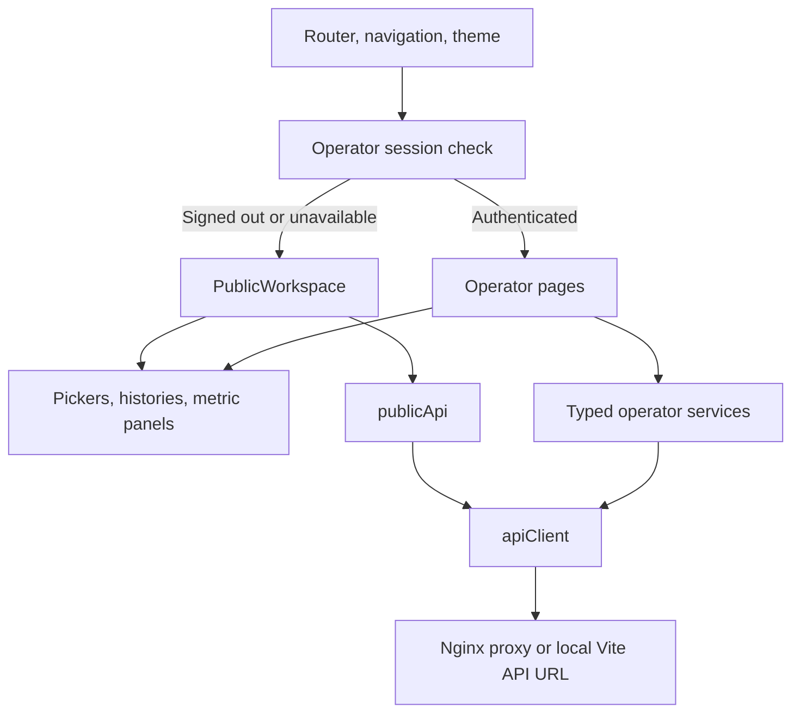
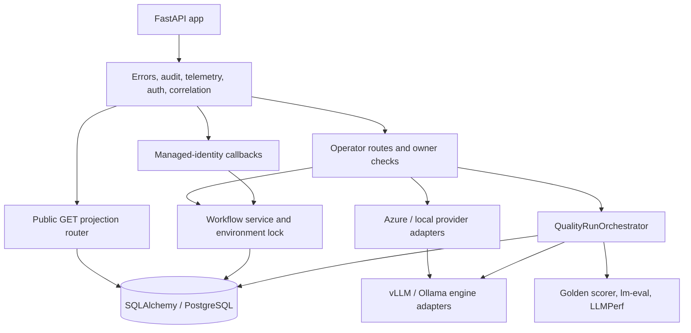
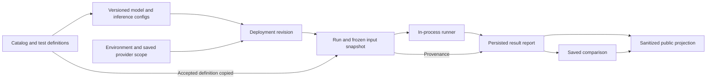

# Components and data lineage

[Architecture map](../ARCHITECTURE.md) / **depth 3** /
[containers](CONTEXT.md#runtime-containers) / [deployment](DEPLOYMENT.md) /
[flows](FLOWS.md)

## Frontend

[`App.tsx`](../../frontend/src/App.tsx) mounts public projections for all routed
screens while signed out, and existing operator pages only after `/session`
verification. [`PublicWorkspace`](../../frontend/src/pages/PublicWorkspace.tsx)
reads profiles/catalog, environments, configurations, definitions, runs, reports
and saved comparisons. It has no submission forms. The server remains the
authorization/redaction boundary, even if a client bypasses disabled controls.

Operator pages are implemented, not scaffolds: Provision, Deploy, Exercise,
Retune, Quality/Performance Run and Report, Compare, Experiment History,
Environment Detail and Teardown. Saving a tuning version does not itself change
traffic; deployment creates a new revision. Exercise history is session-only.
Public data failures and sign-in unavailability have separate retry/error states.

## API and execution

API routes cover catalog, environments, configurations, deployments, prompts,
runs, comparisons, system/session, public projections and internal workflows.
Azure preflight checks the exact effective SKU/region/priority without claiming
physical capacity. Azure provider dispatch and local provider behavior share
contracts, not infrastructure implementations.

`public.py` allowlists finite metrics/tuning fields and removes raw text,
checkpoints, arbitrary arguments, URLs, diagnostics and infrastructure identities.
It never enters the provider/engine layer. `internal_auth.py` validates exact
managed-identity resources separately from `auth.py`'s operator user tokens.

## Persistent lineage

Run acceptance deep-copies environment, revision, model/inference settings and
test definition. Later edits to catalog/definitions must not change accepted
inputs. Model repository ID and checkpoint revision are distinct; serving a
repository literally named `main` is not valid checkpoint resolution.
Report reads use saved lineage rather than today's catalog. Comparisons retain
report/revision/environment relationships and comparability, not a fresh rerun.

Configurations referenced by any deployment revision cannot be deleted;
unreferenced scratch deletion is creator-scoped and lock-coordinated. Keeping a
configuration/report is not backing it up. See [data and recovery](../DATA_AND_RECOVERY.md).

Sources: [`routes`](../../backend/src/api/routes),
[`run acceptance`](../../backend/src/api/routes/runs.py),
[`configurations`](../../backend/src/api/routes/configurations.py),
[`report repository`](../../backend/src/domain/result_report_repo.py),
[`comparison builder`](../../backend/src/domain/comparison_builder.py),
[`domain entities`](../../backend/src/domain),
[`migrations`](../../backend/migrations/versions).
