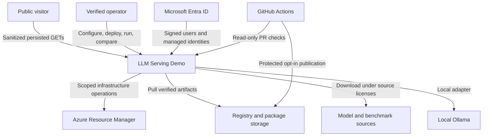
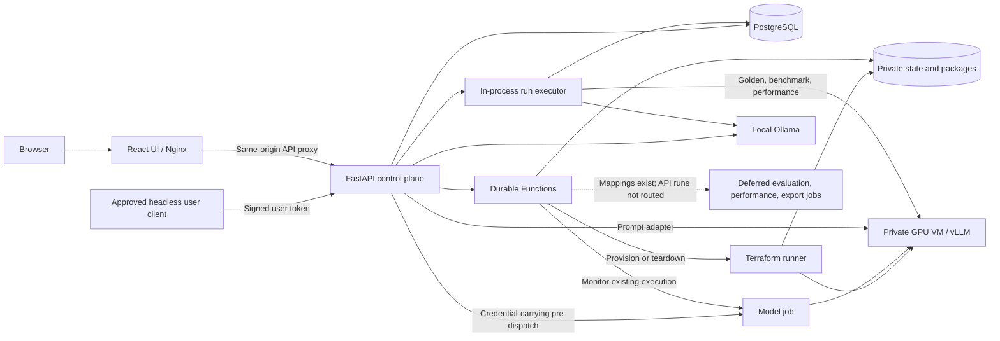

# Context and containers

[Architecture map](../ARCHITECTURE.md) / **depths 1 and 2** /
[components](COMPONENTS.md) / [deployment](DEPLOYMENT.md) / [flows](FLOWS.md)

## System context

The serving lab separates anonymous evidence browsing from authorized operator
actions. Azure runs the persistent control plane and private disposable inference
environments; local development can use an operator-managed Ollama runtime.

The [public demo](https://servinglab.liberatetheinnerchild.net) is not an
anonymous inference endpoint. Azure public ingress is for the UI/control API,
not database, SSH or vLLM ports. Exact public fields and policy are defined in
[authentication](../AUTHENTICATION.md#public-read-only-api).

## Runtime containers

The backend's `QualityRunOrchestrator` runs **both** quality and performance in
its thread pool. Reports survive in PostgreSQL; thread futures do not survive a
backend restart. There is no demonstrated automatic orphan recovery/exactly-once
execution. Do not route to the deferred jobs until report, snapshot, cancellation
and restart/ownership parity is proven.

Local Vite calls an explicit loopback API with exact CORS configuration instead
of the production Nginx transport. Local-demo headers are rejected on cloud hosts.
Ollama is presenter-managed; local “provision” does not allocate cloud resources.

Sources: [`API composition`](../../backend/src/api/app.py),
[`provider registry`](../../backend/src/providers/registry.py),
[`run executor`](../../backend/src/evaluation/run_quality.py),
[`workflow mappings`](../../functions/orchestration_lib/workflow_jobs.py),
[`frontend transport`](../../frontend/nginx.conf).
