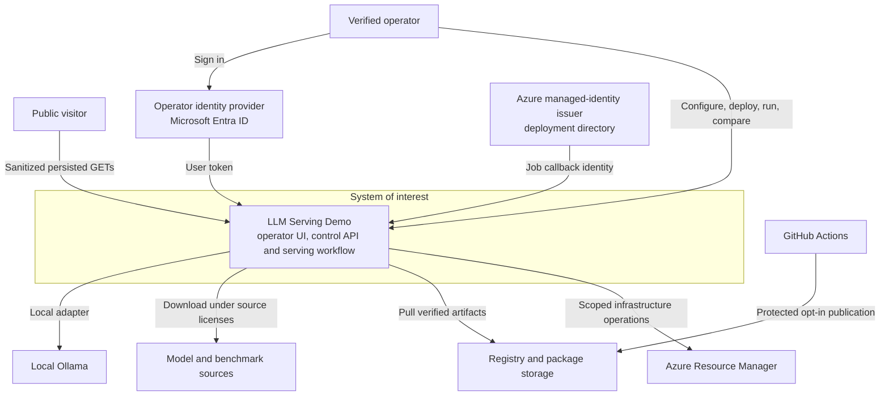
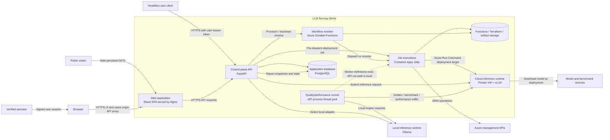

# C4 L1 and L2 — Context and containers

[Architecture map](../ARCHITECTURE.md) / **depths 1 and 2** /
[components](COMPONENTS.md) / [deployment](DEPLOYMENT.md) / [flows](FLOWS.md)

This is the top-down entry point. L1 answers **who needs the system and what
does it connect to?** L2 opens the single system box to show its independently
running applications and stores. Neither view shows request order; use the
[sequence storyboards](FLOWS.md) for that.

## C4 Level 1: System context

**System of interest: LLM Serving Demo.** The system is the reusable serving
lab—not Azure itself, a model vendor, a particular demo environment, or the
repository. People in this view are roles. A “verified operator” is a person
whose user token and application policy were accepted; an Azure workload
identity is a separate machine principal.

The serving lab separates anonymous evidence browsing from authorized operator
actions. Azure runs the persistent control plane and private disposable inference
environments; local development can use an operator-managed Ollama runtime.

**How to read it:** a visitor can read safe saved evidence. An operator can also
request actions through the same application after authentication. Entra supplies
identity through distinct operator and workload principals; the operator tenant
may differ from the deployment directory. ARM performs infrastructure
control-plane actions. Artifact/model
sources supply bytes but do not become trusted merely because a repository names
them. The system uses them only under its package/model handling path.

The [public demo](https://servinglab.liberatetheinnerchild.net) is not an
anonymous inference endpoint. Azure public ingress is for the UI/control API,
not database, SSH or vLLM ports. Exact public fields and policy are defined in
[authentication](../AUTHENTICATION.md#public-read-only-api).

CI appears only as a delivery-side system: ordinary PR checks do not call the
running application. The local Ollama relationship is an **alternative local
execution mode**, not an additional cloud inference service. The diagram does
not claim that every deployment has one or that GitHub Actions executes
production traffic.

## C4 Level 2: Runtime containers

Here, “container” means an independently running software application or data
store in C4; it does not necessarily mean a Docker image. Runtime instances,
network placement, identities and persistent stores are refined in the separate
[deployment view](DEPLOYMENT.md).

### What each container owns

| Container | Responsibility | Not its responsibility |
| --- | --- | --- |
| React SPA / Nginx | Routes browser pages; proxies `/api`; allows only safe public GETs anonymously. | Authorizing a user or filtering sensitive records. |
| FastAPI | Authenticates each request; validates inputs; coordinates domain/provider operations; persists reports and state. | Owning the cloud job's long-running work or acting as an identity provider. |
| Durable Functions | Stores workflow orchestration history, dispatches or monitors one job and handles cancellation/timeout paths. | Applying domain state directly or storing the model access token. |
| Container Apps Job execution | Isolated Terraform or model deployment worker process. | Serving every prompt or running current API quality/performance requests durably. |
| Quality/performance executor | Executes accepted run input in a backend process thread and updates PostgreSQL. | Surviving API process loss; its future and cooperative cancel event are in memory. |
| PostgreSQL | Persists environment/config/revision/workflow/run/report/comparison state. | Proving that an external VM/model or stopped database is currently reachable. |
| Blob/Queue/Table storage | Durable Functions runtime state, manually transferred Terraform state/leases, and artifacts. | A single shared native Terraform backend for every layer. |
| Private GPU VM / vLLM | Runs the deployed cloud model behind private networking. | Public web ingress, durable report storage or the control-plane database. |
| Local Ollama | Supplies an operator-managed local inference endpoint. | Cloud provisioning or a local fake for Azure capacity. |

### Trust and execution boundaries

The public visitor is not a trusted operator. Nginx strips identity headers on
public API requests; the backend admits only exact registered public GET routes
and serializes allowlisted saved projections. Operator requests carry a user
token and are verified by the backend. Internal workflow callbacks use a
different signed managed-identity token, audience and resource allowlist. These
are three different relationships, not one “authenticated app” arrow.

The model job receives an ephemeral gated-model credential through its direct
dispatch. Durable Functions sees the execution name and monitors the job; the
credential must not enter replayable orchestration history, database snapshots,
Terraform variables or diagnostic output. See the [deployment and provenance
view](DEPLOYMENT.md#source-and-artifact-provenance).

The dashed line is intentionally not an active route: job images/mappings exist
for evaluation, performance and export, but API runs still use the in-process
orchestrator. Reports persist; thread futures do not survive API restart. There
is no automatic orphan recovery/exactly-once claim. Do not route to the workers
until snapshots, report semantics, cancellation, failure, restart and ownership
parity have been proved.

Local Vite calls an explicit loopback API with exact CORS configuration instead
of the production Nginx transport. Local-demo headers are rejected on cloud hosts.
Ollama is presenter-managed; local “provision” does not allocate cloud resources.

## Moving to the next level

At L3, follow one running container at a time:
[frontend and API components](COMPONENTS.md),
[Functions components](COMPONENTS.md#functions-container-components).
To see *when* they interact, follow [provision](FLOWS.md#provision-and-teardown),
[deployment](FLOWS.md#deploy-a-model), or [run/report](FLOWS.md#quality-performance-and-report-persistence).
To see source-level composition, use [selected L4 views](CODE.md).

Sources: [`API composition`](../../backend/src/api/app.py),
[`provider registry`](../../backend/src/providers/registry.py),
[`run executor`](../../backend/src/evaluation/run_quality.py),
[`workflow mappings`](../../functions/orchestration_lib/workflow_jobs.py),
[`frontend transport`](../../frontend/nginx.conf),
[`Azure resource layers`](../../infra),
[`vLLM deployment job`](../../jobs/model_deployment/entrypoint.py).
