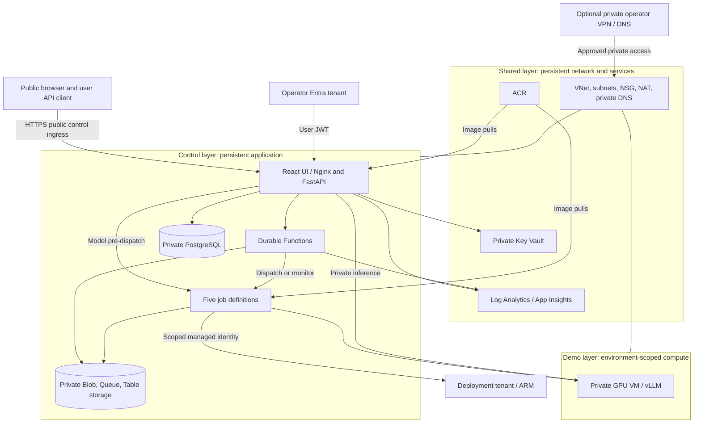
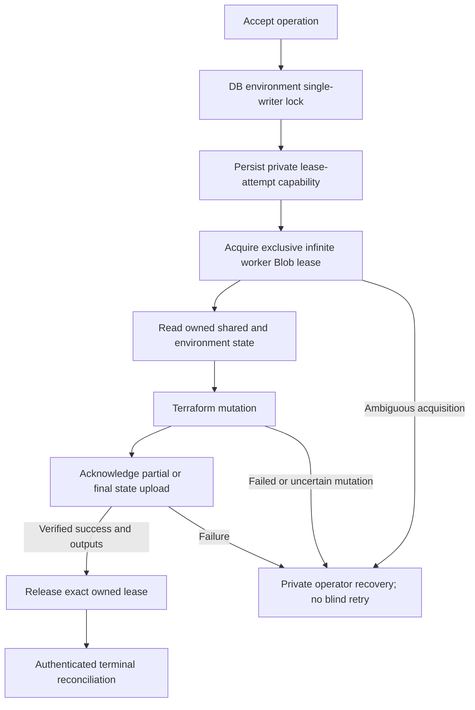

# Deployment, trust and recovery

[Architecture map](../ARCHITECTURE.md) / **deployment depth** /
[containers](CONTEXT.md#runtime-containers) / [components](COMPONENTS.md) /
[sequences](FLOWS.md)

## Azure topology

This is the checked-in topology, not a live-resource inventory. Managed and
retained-group modes differ in ownership, not in permission to operate on
arbitrary existing resources. The default shared/control/demo names are
`rg-llm-shared-{stage}`, `rg-llm-control-{stage}`, `rg-llm-demo-{environmentId}`.
Retained mode uses explicit private operator inputs and fresh data-only group
state; it must not convert/adopt group-owning state. ACA also creates its own
platform infrastructure group, which is not an application teardown target.

The shared layer provides five application subnets: Container Apps, Functions,
data, private endpoints and GPU. NAT is outbound egress, not a public GPU
listener. GPU NICs have no public IP; the VM has no managed identity. Private
database/storage/vault access still needs working routes, DNS and appropriate
data-plane permissions; ARM access alone is insufficient.
[`infra/operator_access`](../../infra/operator_access) is an optional, separately
approved VPN/DNS/state-private-endpoint module, not a default public admin path.
[`infra/bootstrap`](../../infra/bootstrap) proposes retained keyless state storage
and does not automatically migrate or grant backend access.

Operator issuer/tenant may differ from the Azure deployment tenant. Internal
callbacks trust the deployment tenant and exact managed identities; this is not
cross-tenant operator impersonation. Easy Auth exclusions for public reads and
callbacks do not disable backend authorization. See [auth](../AUTHENTICATION.md).

## Source and artifact provenance

```mermaid
flowchart LR
    Source["Reviewed public Git SHA"]
    Checks["Credential-free CI"]
    Images["Seven image archives"]
    ZIP["Dependency-inclusive Functions ZIP"]
    Manifest["Source/run/checksum manifest"]
    Import["Protected approved registry import"]
    Digests["Registry manifest digests"]
    Plan["Private full Terraform plan"]
    Apps["Apps, jobs and Functions"]
    Model["Exact model revision and config"]
    Evidence["Run snapshot and report"]
    Source --> Checks
    Checks --> Images
    Checks --> ZIP
    Images --> Manifest
    ZIP --> Manifest
    Manifest --> Import
    Import --> Digests
    Digests --> Plan
    ZIP -->|Verified checksum and private Blob| Apps
    Plan --> Apps
    Apps --> Model
    Model --> Evidence
```

All seven Dockerfiles are built from the repository root: backend, frontend,
Terraform runner, model deployment, evaluation, performance and export. Package
retention and registry publication are separate operations. A Docker config ID
is **not** the registry manifest pull digest; a Git-SHA tag is traceable but mutable.
Exact Functions ZIP bytes include platform-compatible dependencies. Digest-named
package uploads avoid accidental overwrite but are not immutable-storage policy
or a signed attestation.

`backend.yml`/`frontend.yml` are protected opt-in image updates, not complete
bootstrap. Runtime release packaging, registry import and private full-plan
application have separate gates. Default Terraform placeholders, local
cross-module state and historical success do not make a fresh target reproducible.
Use [Azure gates](../AZURE.md) and [app bootstrap](../APP_BOOTSTRAP.md), including
private database-secret ordering and Functions upload/restart/trigger sync.

Models and benchmarks download from external sources under their own licenses.
The public repo ships no weights/private datasets. Keep exact model revision,
image digests, serving settings, test definitions and tool versions in the private
release manifest and persisted run snapshots.

## Two locks and safe recovery

The DB lock serializes API operations on an environment. The Blob lease
serializes cooperating Terraform workers through read/init/apply/destroy/state
persistence/output validation. It is not an AzureRM native remote backend and
does not fence an external writer that ignores the protocol.

The runner writes a private attempt record **before** lease acquisition, including
the proposed lease UUID. Mutation/persistence/output failures or a killed worker
retain the infinite lease. Initialization failures release it; other recovery
requires proving owner/child-process termination, recovering latest private
state, inventorying exact resources, then releasing only the matching held lease.
Never break/delete the lock, invent state, expire leases into automatic retries
or force-unlock another operation. [The full protocol](../TERRAFORM_STATE.md) is
authoritative; independent billable-resource cleanup is a separate gate.

Sources: [`shared`](../../infra/shared/main.tf),
[`control`](../../infra/control/main.tf), [`demo`](../../infra/demo/main.tf),
[`release packaging`](../../scripts/release_bundle.py),
[`registry import`](../../scripts/azure_release_import.py),
[`DB lock`](../../backend/src/domain/environment_lock.py),
[`worker lease`](../../jobs/terraform_runner/entrypoint.py).
