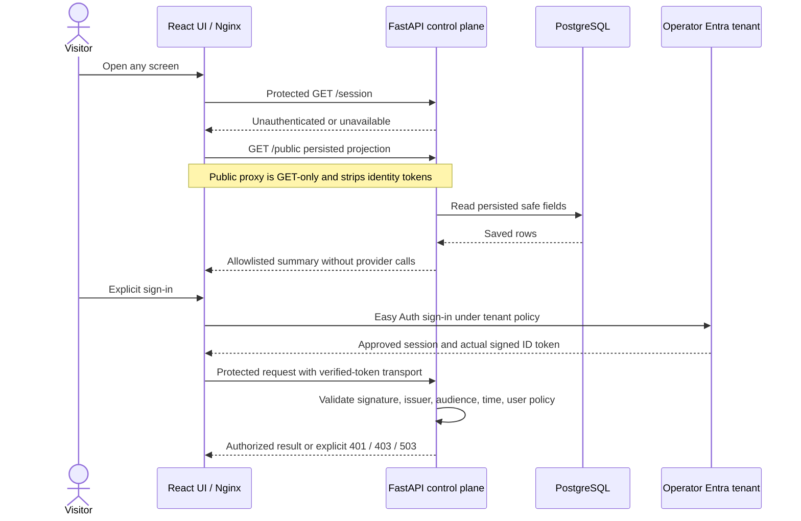
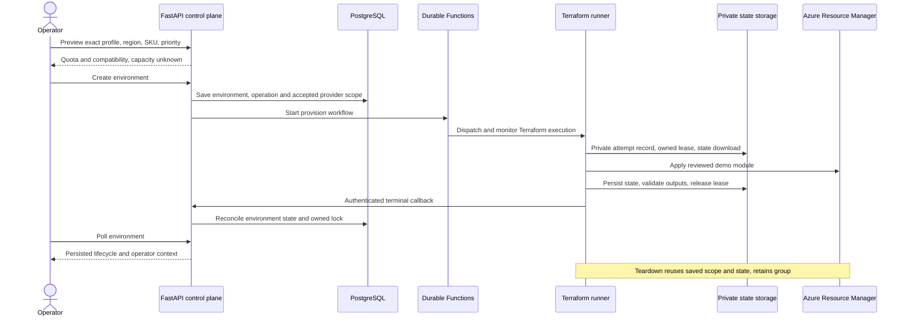
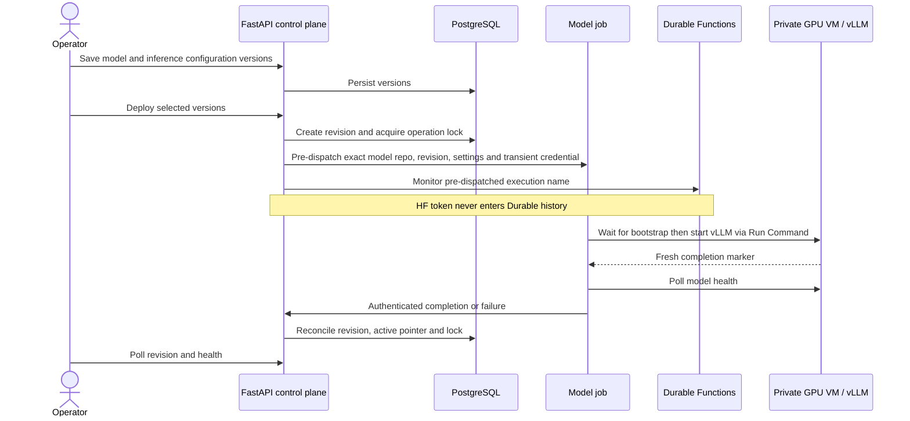
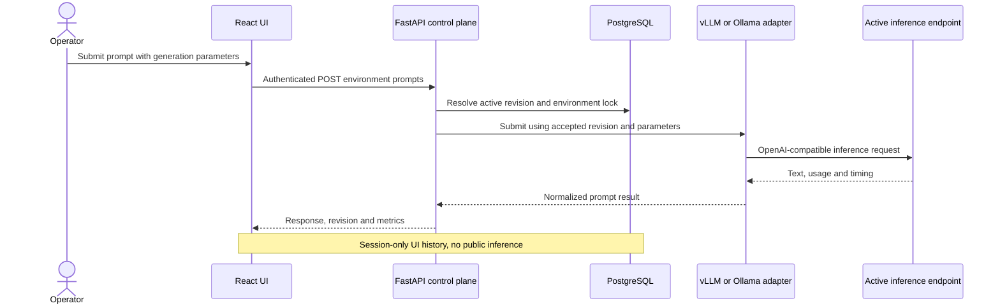
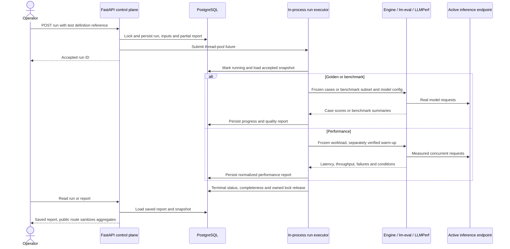

# Runtime sequence flows

[Architecture map](../ARCHITECTURE.md) / **behavior depth** /
[containers](CONTEXT.md#runtime-containers) / [components](COMPONENTS.md) /
[deployment and recovery](DEPLOYMENT.md)

## Public read versus operator action

A platform token header is transport, not proof of identity. Backend validation
and route/owner checks remain mandatory. Internal callbacks instead use their
own managed-identity allowlist. Actual token injection/callbacks/consent must
be verified for each target; local signed-token tests cannot establish it.
See [the complete contract](../AUTHENTICATION.md).

## Provision and teardown

VM provisioning includes fail-fast cloud-init, a bootstrap gate waiting for
cloud-init completion, then the managed NVIDIA extension. A successful Terraform
VM creation is not a ready model. Failed/uncertain mutations retain state/lease
for recovery, not a success callback. Cancellation/timeout in the versioned
Functions monitor waits for SDK stop before terminal finalization; unexpected
callback/stop/ownership errors remain visible.

## Deploy a model

Dispatch itself starts in an API thread pool before Durable monitoring. That
handoff is not demonstrated exactly-once/restart recovery. HF credentials must
not enter DB, Terraform, logs, public evidence or Durable history; cloud job/Run
Command execution-metadata retention still needs private review. Never dump raw
SDK output to diagnose credential-bearing requests.

## Interactive inference

Busy, unavailable or unready environments fail explicitly. Persisted READY is
not a live health guarantee; operators must distinguish stopped/deallocated VM,
running-but-unverified model and successful real inference.

## Quality, performance and report persistence

For vLLM, genuine pinned ray-project LLMPerf performs a separately verified
warm-up before measurement; failures/incomplete warm-up stop the run. Ollama
uses its native streaming measurement path. lm-eval and workload toolkits do not
make small samples representative. [Metric interpretation](../DEMO.md#interpreting-results)
and [evidence](../RELEASE_VALIDATION.md) explain the limits.

Cancellation is cooperative: persist the request, signal the local executor and
let the owning worker acknowledge before releasing the lock. Another replica
must not mark an untracked future cancelled. A directly tracked queued future
may be cancelled before start; running evaluators are not forcibly interrupted.
After process loss, persisted inputs/reports remain but automatic orphan recovery
is not certified. Deferred worker definitions are not this execution path.

Sources: [`provision`](../../backend/src/providers/azure/provision.py),
[`deploy`](../../backend/src/providers/azure/deploy.py),
[`prompts`](../../backend/src/api/routes/prompts.py),
[`runs`](../../backend/src/api/routes/runs.py),
[`executor`](../../backend/src/evaluation/run_quality.py),
[`Functions monitor`](../../functions/orchestrators/generic_orchestrator.py),
[`model job`](../../jobs/model_deployment/entrypoint.py).
